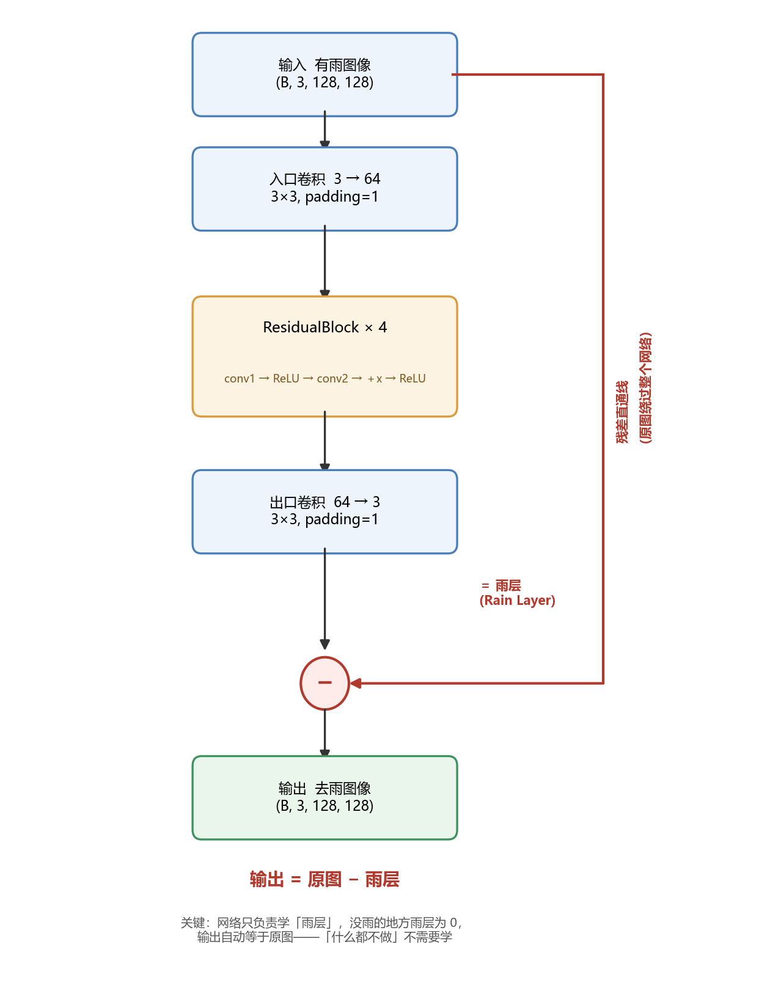

# Part1 任务一：无雨 = 有雨 - 雨层？

## 基础问题 1

题目：我们的输出应该是一张和输入一样大的图像，但我们其实只需要对每一个雨丝所在的位置进行改变。那么，模型应该学习什么？

我选的是残差学习，就是让模型只负责学"雨层"这一样东西，干净图拿原图减掉雨层得到，理由大概是四条

1. 一张图里雨丝只占少数像素，所以"雨层"这张图绝大部分本来就应该是0，网络只要学会"没雨的地方输出0"就已经完成大半了，反过来要是直接学去雨图，就是让网络凭空输出一整张自然图像，每个像素的颜色纹理细节全都得对，等于让它从零画一张照片，目标越稀疏越好学

2. 卷积网络学不好"什么都不做" 图上没被雨影响的那些区域，走直接学习的话理想输出就是原样复制输入，但网络是一层层卷积堆起来的，每一层都在变换数据，要让这一长串变换整体精确等于"不变"，在数学上极难凑，这不是网络笨，是它这个结构天生就不擅长表达恒等映射

    残差结构用一条减法直通线把这件事绕开了

    ```text
    输出 = 输入 − 雨层

    雨层猜成 0  →  输出 = 输入 − 0 = 输入   ← 精确复制，白送
    ```

    于是"复制"从一个需要学的能力变成了天生就会的能力，网络只要操心"该改的地方改多少"

3. 这个思路跟题目本身是一致的，`Q.md` 第 168 行介绍 DeRainNet 的时候就写了"这个图像代表模型学到的雨层（Residual）。最终的去雨图像由原始输入图像减去这个雨层得到"，`models/unet.py` 的 `forward` 里第 41 行 `s = x`、第 58 行 `return self.final_conv(x) + s`，也是留了一条把输入直接送到终点的通路，方向虽然反着（一个是加一个是减），本质都是残差，说明出题人本来就是这个设计思路

4. 这条直通线我真的验证过 把 `BaselineNet` 所有参数的权重和偏置清零，每一层卷积都输出0，那"雨层"就恒等于0，这个时候网络的输出应该精确等于输入

    ```powershell
    python -c "import torch; from models.baseline_net import BaselineNet; \
               m=BaselineNet(); [p.data.zero_() for p in m.parameters()]; \
               x=torch.rand(2,3,128,128); y=m(x); \
               print('max|y-x| =', (y-x).abs().max().item())"
    ```

    跑出来是

    ```text
    max|y-x| = 0.0
    ```

    输入被原封不动地送到了输出。这个实验只能说明一件事：在"雨层输出全 0"这个点上，输出确实严格等于输入，残差这条直通路径接对了。它不能推广成"网络初始化就约等于什么都不做"——默认初始化的参数并不是 0，实测初始化的 PSNR 只有 23.77 dB，比原样输出还低（见任务三 3.1）



图里那条红色的线是残差直通线，也是这张图最关键的地方，原图从最上面出发，绕过整个卷积网络直接连到下面的减法节点，网络那一路只负责产出"雨层"，最后两者一减就是结果

代码里 `BaselineNet.forward` 最后一句就是这件事

```python
def forward(self, x):
    y = x                        # 存下原图
    x = self.convin(x)           # 入口卷积 3 → 64
    x = self.model(x)            # 4 个 ResidualBlock
    x = self.convout(x)          # 出口卷积 64 → 3，得到雨层
    x = y - x                    # 原图 − 雨层
    return x
```

选的是残差学习，所以返回的是"输入图像减卷积输出"，这点得和上面的说法对得上

## 附加问题 1

题目：雨丝在外表上表现出的线性特征，其实也存在于其他物体中（如条纹、纹理等）。在面对这种情况时，模型如何分辨谁是雨丝？

模型其实压根不认识"雨丝"这个概念，它看到的只是一堆像素值，外加一个把它的输出往某个方向推的损失函数

所以它不是在"认出雨"，而是在学"什么样的改动能让输出和那张目标无雨图的损失最小"，在这个约束下雨丝能不能跟别的线状纹理分开，完全取决于它们在训练数据里是不是真的不一样

雨丝在数据上一般有这么几个特点

- 细而且半透明，像一层薄膜盖在背景上，底下的纹理还隐约看得见
- 亮，亮度普遍比周围背景高
- 同一张图里的雨丝方向基本是一致的
- 位置随机，不依附任何物体，落在哪算哪

栏杆、电线、树枝这一类的线状物就不一样了，它们更粗更实，不透明，会把背景完全挡住，位置也是固定的，跟场景结构绑在一起，比如栏杆一定在台阶边上，再加上和背景的对比关系、边缘的锐利程度，这些统计上都跟雨丝对不上

两种东西的统计特征只要真有差别，模型在训练里自然会把它们分开，反过来，要是某条纹理长得跟雨丝一模一样，那模型也分不出来，这是数据决定的上限，不是模型不够聪明，换句话说残差网络能分辨雨丝，靠的不是什么"雨的知识"，而是训练集一遍一遍告诉它：把这些又亮又细的像素减掉，损失才会掉下去

## 附加问题 2

题目：雨非常大时，密集的雨丝可能会完全遮挡住背景的一些细节（比如建筑的轮廓线）。在这种因干扰而难以分辨的情况下，模型还有可能复原出原来的物体吗？

这个要分两种情形来看

第一种是被遮挡了但信息还在 这个任务的训练数据是合成的，`有雨图 = 无雨图 + 雨层`，雨是"加"上去的，从数学上讲只要知道雨层，减一下就能完全恢复，所以理论上只要叠加之后的像素值没有超出表示范围，背景信息就一直都在，只是被盖了一层，是可逆的

第二种是信息真的丢了 能让它变不可逆的情况有两种，一种是像素饱和，雨太亮，叠加之后超过255被截断，超出去的那部分就永远被吞掉了，再怎么减也减不回来，另一种是真实的大雨，雨层不再是简单的线性叠加，多次散射、雾气、镜头上的水膜会从物理上破坏背景，压根不存在"减去雨层"这个操作

所以理论上可逆的那部分可以复原，信息确实丢了的地方，模型只能靠周围的上下文和自然图像的统计规律去"猜"一个看起来最合理的值，补得再像也不是真的复原，只是最可能的猜测，密集遮挡下模型能恢复出大致结构和颜色，但被彻底盖住的细节不可能凭空回来
