# Part1 任务三：我有说明书，太好啦

## 1. 环境搭建：小菜一碟

### 环境信息

| 项 | 值 |
|---|---|
| 环境名 | `derain`（conda） |
| Python 版本 | 3.9.25 |
| 创建方式 | `conda create -n derain --clone pytorch` |
| PyTorch 版本 | 2.7.1+cu128 |
| torchvision 版本 | 0.22.1+cu128 |
| CUDA | 12.8 |
| 显卡 | NVIDIA GeForce RTX 5060 Laptop GPU |
| scikit-image | 0.19.3（必须锁这个版本，原因见下） |

这里我是用 `--clone` 从已有的 `pytorch` 环境复制出来的，没有 `conda create` 从零装，这样既满足了题目"新建一个独立虚拟环境"的要求，又省得重新下那 2.5 GB 的 PyTorch 安装包，克隆出来的环境是完全独立的，之后在里面装什么包都不会影响原来的环境

### 安装过程截图

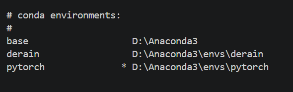

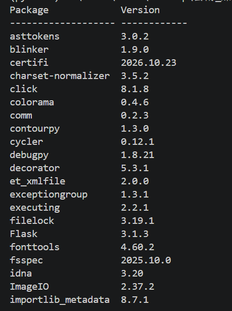

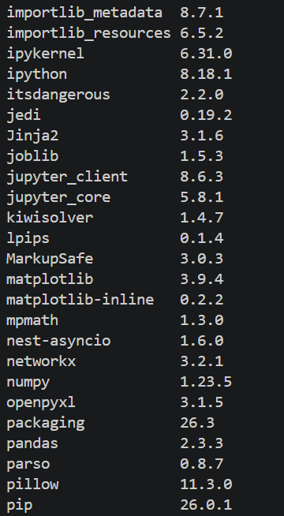

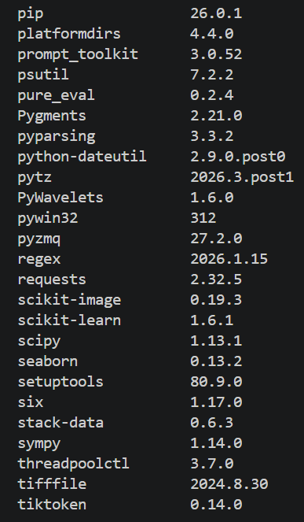

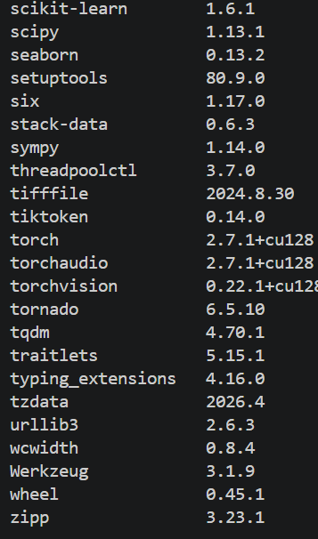

### 遇到的问题

1. `scikit-image` 装新版直接报 TypeError，装完之后跑到算指标那一步就直接崩了

    ```text
    TypeError: ssim() got an unexpected keyword argument 'multichannel'
    ```

    查下来是 `utils.py` 第 18 行用了 `multichannel=True` 这个参数，而 scikit-image 从 0.19.3 之后的版本把它删掉了，换成了 `channel_axis`，新版本不认识这个参数所以直接报错，处理办法就是把版本锁死

    ```bash
    pip install scikit-image==0.19.3
    ```

2. Windows 的"智能应用控制"把 torchvision 的一个扩展模块拦下来了，导入的时候会出这么一条

    ```text
    UserWarning: ... WinError 4551 ...
    ```

    是 `torchvision.io.image` 底下的 `_C.pyd` 被系统拦了，不过这份代码读图用的是 PIL 加 `torchvision.transforms`，压根没走 `torchvision.io`，所以只是个警告不影响训练，确认了这一点之后我就没再管它

3. 数据集解压，Rain200L 下下来是 1 GB 的压缩包，我用 PowerShell 的 `Expand-Archive -Force` 解压到位的，没用 `[System.IO.Compression.ZipFile]` 那个三参数的重载，因为 PowerShell 5.1 的 .NET 版本太老，那个重载压根不存在，会报 `Invalid cast from 'System.Boolean'`

    解压完我检查了一遍目录结构，确认 `train` 和 `test` 下面各有 `input` 和 `target` 两个文件夹，而且文件名是一一对应的，这一点当时觉得很关键，因为 `dataset.py` 就是靠文件名把有雨图和干净图配起来的，文件名对不上它不会报错，只会静默地拿错目标图去训练

    （结果后来还真栽在这上面了，不过不是文件名的问题，是随机翻转的问题，见 `Part2-第一部分-任务二.md`）

## 2. 实现一个简单的模型

### 2.1 BaselineNet 代码

```python
import torch
import torch.nn as nn


class ResidualBlock(nn.Module):
    def __init__(self):
        super().__init__()
        self.conv1 = nn.Conv2d(64, 64, 3, padding=1)
        self.relu = nn.ReLU()
        self.conv2 = nn.Conv2d(64, 64, 3, padding=1)

    def forward(self, x):
        y = x
        x = self.conv1(x)
        x = self.relu(x)
        x = self.conv2(x)
        x = x + y
        x = self.relu(x)
        return x


class BaselineNet(nn.Module):
    def __init__(self):
        super(BaselineNet, self).__init__()
        self.convin = nn.Conv2d(3, 64, 3, padding=1)
        self.model = nn.Sequential(
            ResidualBlock(),
            ResidualBlock(),
            ResidualBlock(),
            ResidualBlock(),
        )
        self.convout = nn.Conv2d(64, 3, 3, padding=1)

    def forward(self, x):
        y = x
        x = self.convin(x)
        x = self.model(x)
        x = self.convout(x)
        x = y - x
        return x
```

`ResidualBlock` 的输出形状和输入完全一样，都是 `(B, 64, 128, 128)`，所以可以随便串

### 设计说明

1. 题目说的"8 层"指的是 4 个 Residual Block，每个 Block 里面 2 个 3×3 卷积，4 × 2 = 8 层，入口的 `convin`（3→64）和出口的 `convout`（64→3）是负责升降通道数的过渡层，不算在这 8 层里

2. 残差相加在 `ResidualBlock.forward` 里的 `x = x + y` 这一行，`y` 是进这个 Block 之前的原始输入，`x` 是两个卷积处理完的结果，两个形状一样可以直接加，加完再过 ReLU 输出

3. `BaselineNet.forward` 最后一句是 `x = y - x`，也就是"原图减网络输出"，这和 `Part1-任务一.md` 里选残差学习是一个道理，`convout` 吐出来的 3 个通道代表的是雨层，不是去完雨的图，干净图得拿原图减掉雨层才是

    这样写的好处是网络不用学"原样复制输入"，只要雨层输出接近0，输出就自动等于输入，没被雨影响的地方天然就保下来了

4. `padding` 之所以都取 1，是因为 3×3 卷积不加 padding 的话每层会让特征图的长和宽各缩 2，4 个 Block 一共 8 层，缩下去就累积到 16 个像素了，128×128 的图最后根本对不上，取 `padding=1` 相当于在边缘补一圈0，输出尺寸和输入保持一致，残差相加也才成立

### 参数量核对

```text
模型总参数量：298,947  ≈ 0.299 M
```

手算核对

```text
每个 64→64 的 3×3 卷积：
    64 × 64 × 3 × 3 = 36,864 个权重
    + 64 个 bias    = 36,928

一个 ResidualBlock（2 个卷积）：
    36,928 × 2      = 73,856

4 个 Block：
    73,856 × 4      = 295,424

入口卷积 3→64：
    3 × 64 × 3 × 3 + 64  = 1,792

出口卷积 64→3：
    64 × 3 × 3 × 3 + 3   = 1,731

合计：
    295,424 + 1,792 + 1,731 = 298,947
```

和 `sum(p.numel() for p in model.parameters())` 打出来的数字对得上

### 2.2 思考题：3×3 卷积感受野有限的问题

一个 3×3 卷积只能看到相邻那 3×3 的一块，每加深一层感受野加 2，所以 n 层 3×3 的感受野是 2n+1，要覆盖一条贯穿整幅 128×128 图的雨线，理论上得堆到 64 层左右，而分类任务里靠池化层不断缩小特征图，尺寸降一半，同样大的卷积核覆盖的原图范围就翻倍，感受野是指数级长的

但去雨这个任务偏偏不能这么干，一池化就丢空间细节，而任务要求输出和输入得逐像素对齐，矛盾就在这儿，要保持分辨率就不能降采样，不降采样感受野只能线性长，堆到足够深又训不动

绕开这个矛盾的路子大概有四类

1. 下采样再上采样（编码器-解码器），先把图整体缩小，在小尺寸上做卷积，这时候同样大的核覆盖的原图范围就变得很大，处理完再上采样放大回原尺寸，中间过程分辨率是降了，但最终输出还是全分辨率

    仓库里的 `models/unet.py` 走的就是这条路，`self.pool(x)` 一路下采样三次，再用 `ConvTranspose2d` 一路放大回来，中间的 `torch.cat` 把编码器那边的高分辨率特征直接接到解码器上，补一下下采样丢掉的细节，相当于用"先缩小"换来感受野，再用"上采样加跳连"把分辨率还回去

2. 空洞卷积，在卷积核的采样点之间插空洞，让 3×3 的核实际能覆盖 5×5、7×7 甚至更大，参数量不变，特征图尺寸也不变，每个输出位置的乘加次数同样不变——权重还是那 9 个，所以计算量并没有上去，等于一次性绕开了矛盾。代价在别的地方：采样点是跳着采的，点与点之间那些像素完全没被看到，膨胀率一高就容易漏掉细小的结构，还会出现棋盘状的伪影

3. 干脆跳出局部卷积，让所有位置直接互相看见，卷积的局部性本来就是感受野受限的根源，而注意力机制让每个位置直接和所有位置算相关性，感受野一开始就是全图，压根不存在"堆深度扩感受野"这回事，代价是计算量随分辨率平方增长，所以一般还得靠窗口划分或者下采样来压开销

4. 残差连接，让深网络训得动，前三类都是在想办法"扩大感受野"，这一类是让"堆深"这件事本身变得可行，残差连接把恒等映射做成一条直通线，梯度可以顺着短路回传，缓解深层网络的梯度消失，这样就算真堆到几十层也训得动

如果要我二选一的话，下采样加上采样是最务实的（`unet.py` 就是这么干的），要求严格保持分辨率就用空洞卷积，算力允许的话注意力是唯一真正一步到位解决长距离依赖的

## 3. 这个代码是什么意思？

### 3.1 训练运行结果

运行命令就这一行

```bash
python main.py --data_dir "./data/Rain200L" --model baseline --mode train --epochs 100
```

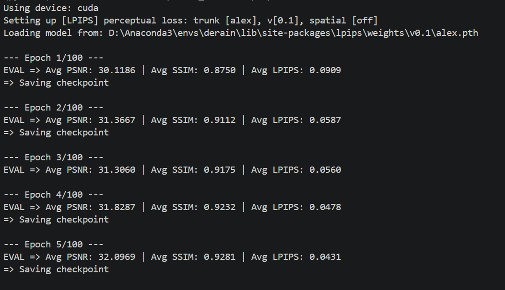

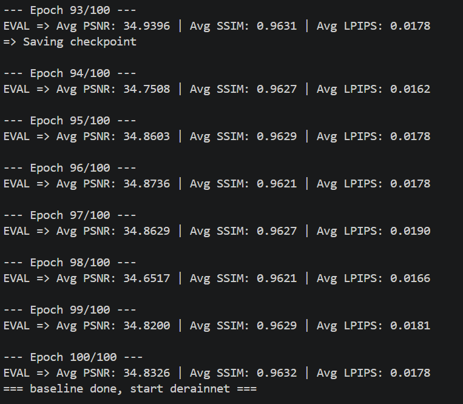

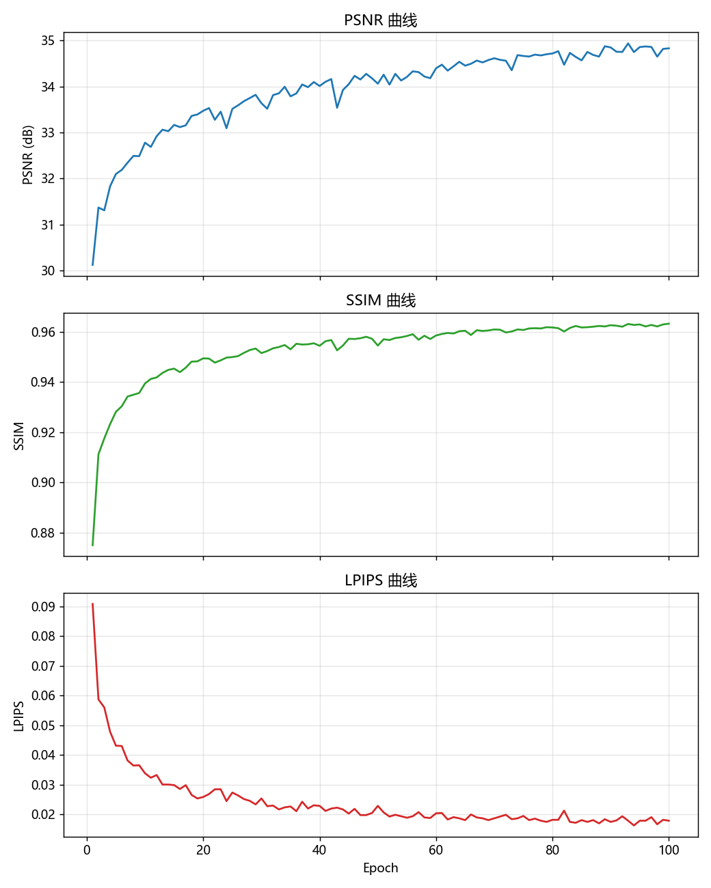

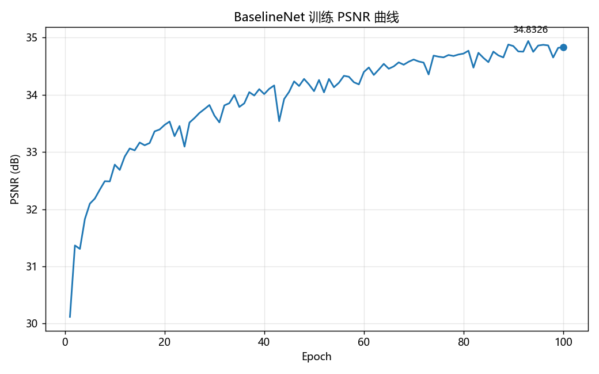

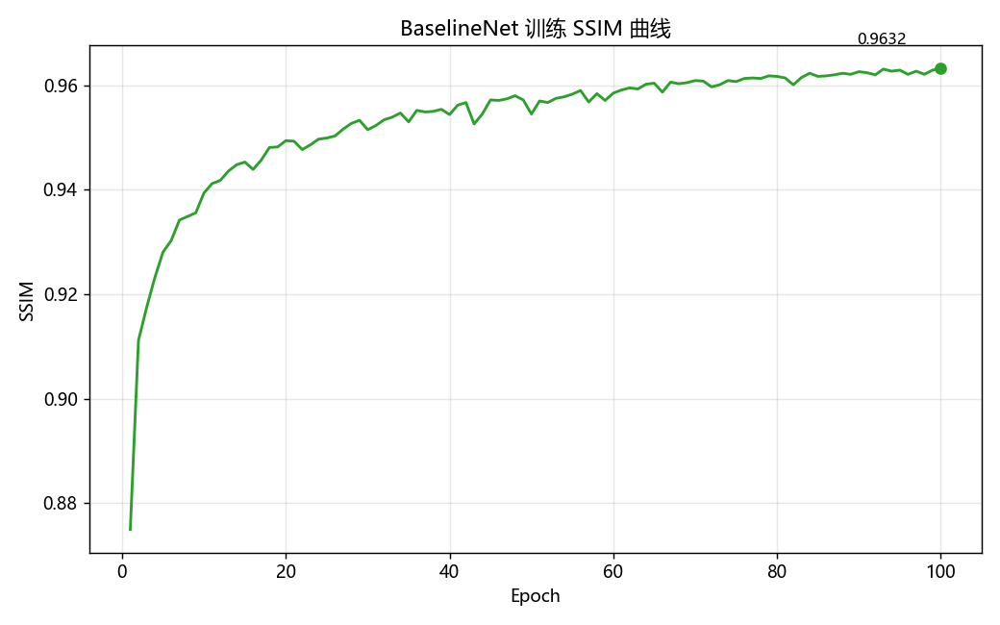

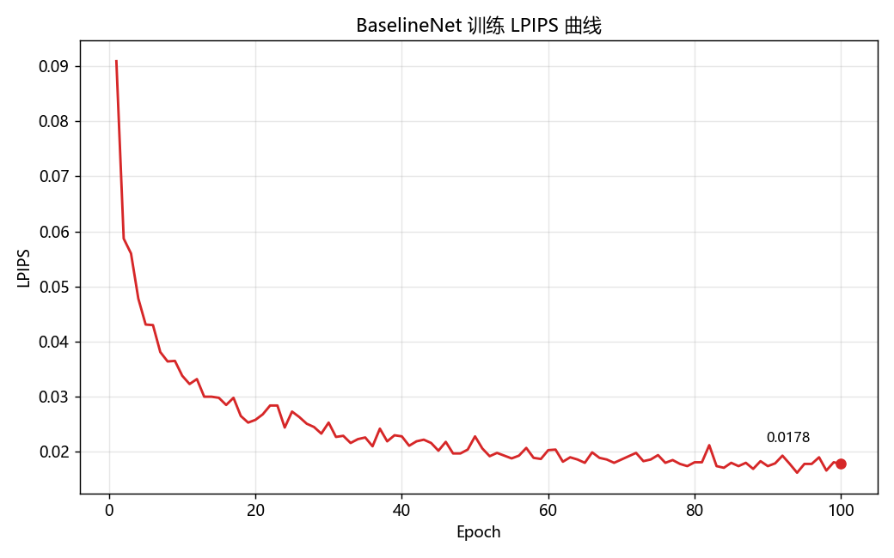

下面两张对比图，每行 8 张测试图，从上到下依次是有雨输入、模型输出、干净真值

第 1 轮的时候模型基本什么都没做

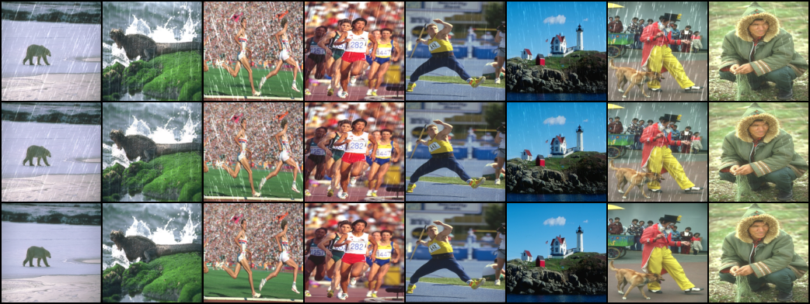

第 100 轮

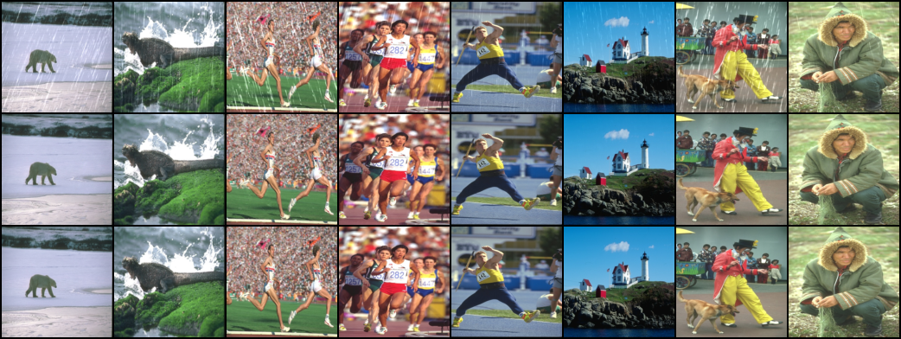

第 1 轮的输出跟带雨的原图已经很接近了，因为残差结构只要把雨层压到很小就能做到"几乎原样输出"，这个起点比随机初始化好得多；到第 100 轮雨丝被明显去掉了，同时背景的纹理和颜色基本还在

指标汇总

| Epoch | PSNR | SSIM | LPIPS |
|---|---|---|---|
| 1 | 30.1186 | 0.8750 | 0.0909 |
| 5 | 32.0969 | 0.9281 | 0.0431 |
| 10 | 32.7791 | 0.9394 | 0.0338 |
| 25 | 33.5148 | 0.9499 | 0.0273 |
| 50 | 34.0635 | 0.9545 | 0.0228 |
| 75 | 34.6662 | 0.9607 | 0.0194 |
| 90 | 34.8520 | 0.9626 | 0.0174 |
| 100 | 34.8326 | 0.9632 | 0.0178 |

训练过程中 PSNR 最高落在第 93 轮，34.9396

有一点我觉得值得说一下，第 1 轮的 PSNR 就已经有 30.1186 了，看着像是"白给"的，我一开始也这么以为，后来实际量了一下，不是

我用仓库自己的 `DerainDataset`（128×128）和 `my_psnr`，把测试集 200 对全跑了一遍，比了三种情况

```text
什么都不做（输出 = 有雨图）      27.89 dB
BaselineNet 默认初始化           23.77 dB
第 1 轮训练后                    30.12 dB
```

默认初始化的时候雨层并不接近全黑，实测 `|雨层|` 的平均值约 0.065（像素值域 0~1），超过一半的像素被减掉 5% 以上。也就是说随机初始化时网络其实是在乱减，PSNR 比"什么都不做"还低 4 dB

所以第 1 轮这 30.12 是训练一个 epoch 之后拿到的，比"什么都不做"高 2.2 dB，比初始化高 6.3 dB，不是残差结构白送的。残差结构真正给的是"学成恒等"这个解离得很近——只要把残差分支压到 0 就行，所以好训；但默认初始化并不会自动停在那个解上。想让它初始化即恒等，得把出口卷积零初始化，也就是 Part2 里给 `DerainNet` 做的那个 `nn.init.zeros_`

之后的进步是从 30.12 到 34.83 这 4.7 dB，主要来自在雨丝所在的那少数几个位置把该减的减对

三条曲线的走势也印证这一点，PSNR 和 SSIM 在最后 20 轮明显变缓还上下波动（PSNR 在 34.6 到 34.9 之间来回），说明模型已经摸到这个结构在当前设置下的上限了，再训收益很小，LPIPS 掉得最快的是前 20 轮（0.0909 到大概 0.034），之后基本就平了

关于这组数字的来源还想补一句，一开始跑出来的结果是 33.6307，我写这份报告的时候也是这么记的，后来做 Part2 排查 DerainNet 不收敛的时候才发现 `dataset.py` 里的随机水平翻转是对输入图和目标图各掷一次骰子，导致大概一半的训练样本"有雨图没翻、干净图翻了"，配对错了，等于拿 A 的输入去学 B 的输出，把翻转改成同一个随机数同步控制两张图之后重训，baseline 从 33.6307 提到了 34.8326，涨了 1.2 dB，上面这张表是修正后重训的结果，现在仓库里的代码跑出来就是这个数，详细过程在 `Part2-第一部分-任务二.md` 第 2 节

### 3.2 学到的代码相关新东西

1. `num_workers` 是在用多进程提前把数据准备好，`main.py` 里写的是 `DataLoader(..., num_workers=4)`，我一开始以为这就是个"开几个线程加速"的参数，后来才明白它开的是独立进程，专门负责读图、解码、变换，把准备好的 batch 塞进队列，GPU 直接取，要是设成 0，读图就在主进程里串行做，GPU 每批都得停下来等硬盘，利用率低得离谱，设成 4 差不多等于雇了 4 个工人一直不停地在备下一批货

2. `model.eval()` 和 `model.train()` 必须成对切，`evaluate()` 开头有 `model.eval()`，`train_one_epoch()` 开头有 `model.train()`，`utils.py` 里的 `save_some_examples` 在存完图之后还专门写了一句 `model.train()` 切回去。我起初以为这就是个可有可无的开关，后来才明白它管的是两类层的**行为**（不是参数）：eval 模式下 BatchNorm 改用累计的 running 统计量、不再更新，Dropout 直接关掉。所以忘了切回来，下一轮就会在推理模式下训练，数值悄悄变，而且一个错都不报

    有一点要说明白：这个坑在本次的模型上踩不到。仓库里 `baseline`、`unet`、`DerainNet` 全是卷积加 ReLU，一个 BatchNorm、一个 Dropout 都没有，切错了数值完全一样。但习惯必须养成——换成 ResNet 这类带 BN 的骨干，忘了切回去就是上面那个后果

3. `tqdm` 是把可迭代对象包一层就给你一个进度条

    ```python
    loop = tqdm(loader, leave=True)
    for _, (rainy, clean, _) in enumerate(loop):
        loop.set_postfix(pixel_loss=pixel_loss.item())
    ```

    `tqdm(loader)` 返回的东西本身还是能迭代的，但每取一个元素就在终端刷一次进度，`set_postfix` 能在进度条尾巴上挂实时的 loss，不用改循环逻辑，只把 `loader` 包一层就行，这点比我想象的优雅多了

### 3.3（附加）手写 PSNR

公式

```text
PSNR = 10 × log₁₀( data_range² / MSE )
```

代码写在 `utils.py` 里

```python
def my_psnr(img1, img2, data_range=1.0):
    MSE = np.mean((img1 - img2) ** 2)
    if MSE == 0:
        return float("inf")
    PSNR = 10 * np.log10(data_range ** 2 / MSE)
    return PSNR
```

然后把 `calculate_metrics` 里的库函数调用换成它，顺便把 `from skimage.metrics import peak_signal_noise_ratio` 这行删掉（SSIM 那个 import 留着）

写的时候踩了三个点

1. MSE 必须对全部元素求平均，`(128, 128, 3)` 一共 49152 个数，得用 `np.mean` 一次算完，不是分通道各算各的再平均

2. `MSE == 0` 的判断必须放在除法前面，两张图完全一样的时候 MSE 是 0，要是先算除法再判断，那时候除零已经发生了

3. 边界情况返回 `float("inf")`，不能返回字符串，因为 `calculate_metrics` 里是 `batch_psnr += psnr(...)`，这个返回值要参与加法和除法，扔个字符串进去整个流程直接 `TypeError`

为了确认第三点到底该怎么写，我先跑了一次 skimage 的原版看它自己是怎么处理的

```text
RuntimeWarning: divide by zero encountered in double_scalars
  return 10 * np.log10((data_range ** 2) / err)
inf
```

它也没做什么特殊处理，就是让 numpy 自然产生一个 `inf`，所以我这边也返回 `inf`，跟库函数保持一致

验证的时候我拿同一对图两边各算一次

| 对比项 | 我的实现 | skimage 库函数 | 差值 |
|---|---|---|---|
| 有雨图 vs 干净图（同一张，差距较大） | 29.260949 | 29.260949 | 0.00e+00 |
| 干净图 vs 另一张干净图（差距很大） | 8.742907 | 8.742907 | 0.00e+00 |
| 干净图 vs 它自己（完全相同，MSE = 0） | inf | inf | 0.00e+00 |

一般差异、大差异、退化情况三种全都一样，一点没差

然后是整体回归，把 `utils.py` 里的调用换成 `my_psnr` 之后，拿训好的权重跑一次测试

```bash
python main.py --data_dir "./data/Rain200L" --model baseline --mode test \
    --checkpoint "checkpoints/best_baseline.pth.tar"
```

```text
EVAL => Avg PSNR: 34.9396 | Avg SSIM: 0.9631 | Avg LPIPS: 0.0178
```

这个结果和训练日志里第 93 轮的 `EVAL => Avg PSNR: 34.9396 | Avg SSIM: 0.9631 | Avg LPIPS: 0.0178` 完全一致（`best_baseline.pth.tar` 存的就是第 93 轮那份最优权重），说明自己写的 PSNR 在完整的训练测试流程里跟库函数是等价的，不是单独调用的时候对得上而已

顺带提一句，`calculate_metrics` 里换掉的只是评估阶段的 PSNR 计算，跟训练用的损失函数（Part2 才讨论的 L1、L2）是两码事，互不影响
