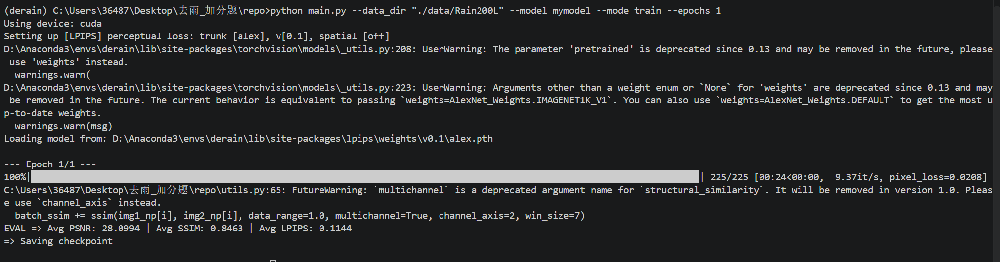

# Part2 第一部分 任务一：搞了半天原来要自己写

## 1. 任务拆解

题干提了三条要求

1. 在 `get_args` 函数里加上 "derainnet" 和 "mymodel" 两个 choice
2. 在 `models` 里建 `DerainNet` 和 `Mymodel` 两个代码文件，用最简单的方式写一个模型类，再导入到 `main.py`
3. 照着 `"baseline"` 和 `"unet"` 的设计方式，把 `main` 函数里 `args.model` 的判断条件补上

第二条里那个"用最简单的方式"要注意一下，这一步的目标压根不是做出一个好模型，而是先把管道打通，让 `--model derainnet` 能在终端里敲下去、能找到类、能跑完一轮、能出结果，所以模型本身写两层卷积就够了，真正有结构的设计放到任务二再说

## 2. 第一步：在 `get_args` 里加两个 choice

原来的参数定义长这样

```python
parser.add_argument("--model", type=str, default="baseline",
                    choices=["baseline", "unet"], help="Model to use")
```

改成

```python
parser.add_argument("--model", type=str, default="baseline",
                    choices=["baseline", "unet", "derainnet", "mymodel"],
                    help="Model to use")
```

`choices` 是 argparse 给的一个白名单，加上之后命令行里要是敲了名单外的值，程序启动的时候就会立刻报错还把合法选项全列出来

```text
main.py: error: argument --model: invalid choice: 'derinnet'
(choose from 'baseline', 'unet', 'derainnet', 'mymodel')
```

这比跑到一半才因为找不到类崩掉好太多了，比如把 `derainnet` 敲成 `derinnet`，有 `choices` 的话一眼就能看出是拼错，没有的话得等到构建模型那一步才报 `NameError`，中间可能已经白等了十几秒

## 3. 第二步：建两个模型文件

### 3.1 `models/derainnet.py`（任务一阶段）

题干说用最简单的方式，那就照着 `BaselineNet` 改，换个类名，把 Block 从 4 个减到 1 个

```python
import torch
import torch.nn as nn
from models.baseline_net import ResidualBlock


class DerainNet(nn.Module):
    def __init__(self):
        super(DerainNet, self).__init__()
        self.convin = nn.Conv2d(3, 64, 3, padding=1)
        self.block = ResidualBlock()
        self.convout = nn.Conv2d(64, 3, 3, padding=1)

    def forward(self, x):
        y = x
        x = self.convin(x)
        x = self.block(x)
        x = self.convout(x)
        return y - x
```

参数量

```text
入口卷积 3→64        1,792
1 个 ResidualBlock  73,856
出口卷积 64→3         1,731
                ───────────
                合计 77,379
```

有三点想说一下

1. `ResidualBlock` 我是直接从 `baseline_net.py` 里导入的，没有抄第二遍，抄一遍的话两个文件里就会有两份定义，以后改了一处忘了另一处，这种是最难查的

2. 结构还是残差的，最后一句 `return y - x`，`convout` 输出的是雨层不是去完雨的图，这跟 Part1 任务一里选残差学习是一个道理，网络不用学"原样复制输入"，只要雨层接近0，输出自动就等于输入

3. 这里就是故意写得很简单，它是任务二的起点不是终点，任务二会把这个文件整个重写成三分支多尺度的结构（见 `Part2-第一部分-任务二.md`）

### 3.2 `models/mymodel.py`

"最简单的方式"的极限版本，入口卷积加出口卷积，中间什么都不放

```python
import torch
import torch.nn as nn


class MyModel(nn.Module):
    def __init__(self):
        super(MyModel, self).__init__()
        self.convin = nn.Conv2d(3, 64, 3, padding=1)
        self.convout = nn.Conv2d(64, 3, 3, padding=1)

    def forward(self, x):
        y = x
        x = self.convin(x)
        x = self.convout(x)
        return y - x
```

参数量

```text
入口卷积 3→64     1,792
出口卷积 64→3     1,731
              ──────────
              合计 3,523
```

这个模型一共就两层卷积，几乎没什么表达能力，但任务一本来就是为了验证管道通没通，不是验证模型好不好，它能跑完、形状对、能出结果，任务一就算完事了

写的时候还发现一个事，两层卷积中间是必须有非线性激活的，不然两个线性变换在数学上等价于一个卷积，中间那层等于白加，我这个简化版没加 ReLU，等于实际只有一个 3×3 卷积在起作用，简化版这样写可以接受，但真想拿它训练的话必须补上

## 4. 第三步：在 `main` 里补分支

原来的写法只处理两种模型

```python
if args.model == "baseline":
    model = BaselineNet().to(device)
elif args.model == "unet":
    model = UNet().to(device)
```

照着同样的样子补两条

```python
if args.model == "baseline":
    model = BaselineNet().to(device)
elif args.model == "unet":
    model = UNet().to(device)
elif args.model == "derainnet":
    model = DerainNet().to(device)
elif args.model == "mymodel":
    model = MyModel().to(device)
```

同时在文件开头把两个新类导进来

```python
from models.derainnet import DerainNet
from models.mymodel import MyModel
```

这里我犹豫过要不要改用字典，因为字典写起来短很多

```python
MODELS = {"baseline": BaselineNet, "unet": UNet,
          "derainnet": DerainNet, "mymodel": MyModel}
model = MODELS[args.model]().to(device)
```

最后没用，是因为 `choices` 和 `MODELS` 是两份独立维护的表，argparse 那边一份、代码这边一份，加模型的时候得改两处，忘了改哪一处都是运行时才报错，`if/elif` 虽然啰嗦，但跟 `choices` 的写法是一一对应的，抄的时候不容易漏

不过反过来说，要是这个仓库本来就打算一直往里塞新模型，字典方案配上 `choices=list(MODELS)` 反而更不容易出错，两种写法其实都能接受，我最后选了跟原代码保持一致

还有 `.to(device)` 一定不能忘，模型和数据得在同一个设备上，不然会报 `Expected all tensors to be on the same device`，原代码里每个分支后面都跟着 `.to(device)`，新加的两条也照抄了

## 5. 顺带加的一个参数：`--loss`

这个是我自己加的，题干没要求，但如果不加会有个实际问题

Part2 明确规定"本部分中，我们规定：损失函数只能使用 L2 Loss"，可 `main.py` 里原本写死的是 L1

```python
pixel_loss_fn = nn.L1Loss()
```

要是直接把它改成 `nn.MSELoss()`，Part1 的结果就没法复现了，Part1 的报告里写着 PSNR 34.94，那是 L1 训出来的，改成 L2 重新跑会得到完全不同的数，评审拿代码一跑就跟报告对不上

所以我把它做成了命令行参数，默认值保持 `"l1"`

```python
parser.add_argument("--loss", type=str, default="l1",
                    choices=["l1", "l2"],
                    help="Pixel loss type")
```

```python
if args.loss == "l1":
    pixel_loss_fn = nn.L1Loss()
else:
    pixel_loss_fn = nn.MSELoss()
```

这样一来，不加 `--loss` 的时候行为和原来完全一样，Part1 的命令 `python main.py --model baseline --mode train` 一个字都不用改，结果能逐位复现，Part2 的 DerainNet 用 `--model derainnet --loss l2` 就能跑 L2

这个一般叫向后兼容，就是新增功能的同时保证旧的调用方式还能拿到旧的结果

说实话这个点是做的过程中才意识到的，我一开始想的就是直接把 `L1Loss()` 换成 `MSELoss()`，后来才反应过来"这样交上去之后 Part1 的报告跟代码就对不上了"，才改成加参数，事后看这个决定比写模型本身更值得讲，改一个已经有人在用的东西的时候，第一反应应该是"怎么改才不破坏现有的用法"，而不是"怎么改最快"

## 6. 验证

### 6.1 两个模型都能构建

```bash
python -c "import torch; from models.derainnet import DerainNet; from models.mymodel import MyModel; print(sum(p.numel() for p in DerainNet().parameters()), sum(p.numel() for p in MyModel().parameters()))"
```

```text
77379 3523
```

和手算的对得上

### 6.2 四个模型都能被命令行选中

```bash
python main.py --data_dir "./data/Rain200L" --model mymodel --mode train --epochs 1
```



能正常跑完一轮，说明 `choices`、导入、`if/elif` 分支这三处都接对了，指标是 `PSNR 28.0994 / SSIM 0.8463 / LPIPS 0.1144`，这个数确实很一般，毕竟它就是个两层卷积，不过这也是 `Part2-第一部分-任务二.md` 要解决的问题了

### 6.3 Part1 的用法没有被破坏

```bash
python main.py --data_dir "./data/Rain200L" --model baseline --mode test \
    --checkpoint "checkpoints/best_baseline.pth.tar"
```

不加 `--loss` 的时候，行为和加这个参数之前完全一样
