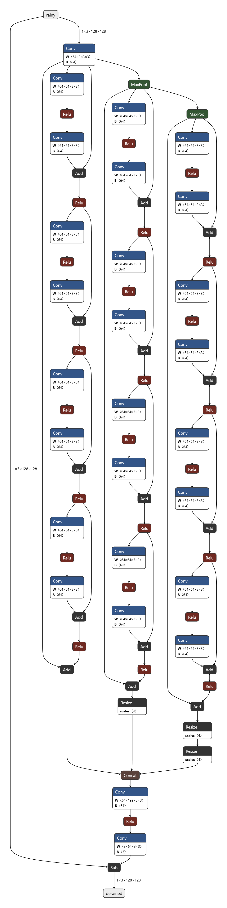
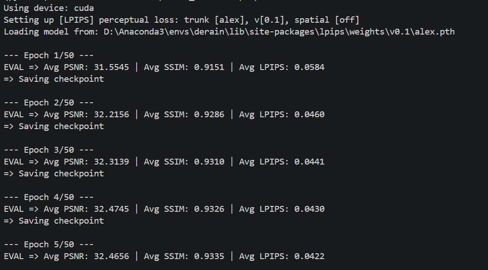
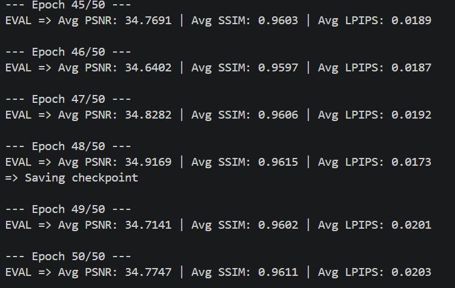
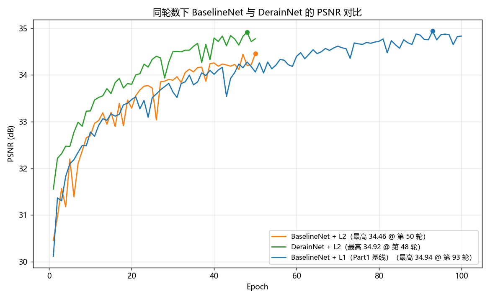

# Part2 第一部分 任务二：试试看前人的杰作

## 1. 模型结构

### 1.1 一句话概括

`BaselineNet` 像是独栋，一条直路走到底，`DerainNet` 像是三栋楼并排，同一张图先过入口卷积，然后分成三路，分别在原尺寸、1/2、1/4 三种尺度上各走 4 个 ResidualBlock，最后全部放大回 128×128，沿着通道拼起来，再用一个融合卷积压成一个 3 通道的雨层

```text
输入 (B, 3, 128, 128)
   │
   ▼  convin  3 → 64
 f (B, 64, 128, 128)
   │
   ├──────────────┬───────────────────┬──────────────────────┐
   │              │                   │                      │
   ▼ 分支0         ▼ pool(2)           ▼ pool(2)
                  x1 (B,64,64,64)    x2 (B,64,32,32)
   │              │                   │
   ▼ 4×Block      ▼ 4×Block           ▼ 4×Block
   │ + x          │ + x1              │ + x2
   │              │                   │
   │              ▼ up(×2)            ▼ up(×2) 两次
   │              │                   │
 b0 (64ch)      b1 (64ch)           b2 (64ch)
   │              │                   │
   └──────────────┴───────────────────┘
                  │
                  ▼ torch.cat(dim=1) → (B, 192, 128, 128)
                  │
                  ▼ convtotal: 192→64 (ReLU) →64→3
               rain (B, 3, 128, 128)
                  │
                  ▼ 原图 − rain
              输出 (B, 3, 128, 128)
```

### 1.2 关于「8 层 ResBlock」

题干写的是"使用不同 8 层 ResBlock"，这个 8 层指的是 8 个卷积层，也就是 4 个 ResidualBlock，每个 Block 里面 2 个 3×3 卷积，这和 Part1 里 `BaselineNet` 的"8 层"是同一个数法，入口卷积和融合卷积是负责升降通道数的过渡层，不算在这 8 层里

三支各 4 个 Block，所以整个模型一共 12 个 ResidualBlock、24 个卷积层

### 1.3 代码

`models/derainnet.py`

```python
import torch
import torch.nn as nn
from models.baseline_net import ResidualBlock


class DerainNet(nn.Module):
    def __init__(self):
        super(DerainNet, self).__init__()
        self.convin = nn.Conv2d(3, 64, 3, padding=1)

        self.model1 = nn.Sequential(
            ResidualBlock(), ResidualBlock(), ResidualBlock(), ResidualBlock(),
        )
        self.model2 = nn.Sequential(
            ResidualBlock(), ResidualBlock(), ResidualBlock(), ResidualBlock(),
        )
        self.model3 = nn.Sequential(
            ResidualBlock(), ResidualBlock(), ResidualBlock(), ResidualBlock(),
        )

        self.pool = nn.MaxPool2d(2)
        self.up = nn.Upsample(scale_factor=2, mode='bilinear', align_corners=False)

        self.convtotal = nn.Sequential(
            nn.Conv2d(192, 64, 3, padding=1),
            nn.ReLU(),
            nn.Conv2d(64, 3, 3, padding=1),
        )

        # 融合层的最后一个卷积零初始化，理由见 1.6
        nn.init.zeros_(self.convtotal[2].weight)
        nn.init.zeros_(self.convtotal[2].bias)

    def forward(self, x):
        y = x
        x = self.convin(x)

        b0 = self.model1(x) + x

        x1 = self.pool(x)
        b1 = self.model2(x1) + x1
        b1 = self.up(b1)

        x2 = self.pool(x1)
        b2 = self.model3(x2) + x2
        b2 = self.up(self.up(b2))

        out = torch.cat([b0, b1, b2], dim=1)
        rain = self.convtotal(out)
        return y - rain
```

`ResidualBlock` 还是直接从 `models/baseline_net.py` 导进来的，没抄第二遍，抄两遍的话两份定义一旦不同步，以后改了一处忘了另一处，是很难查的那种问题

### 1.4 参数量核对

```text
入口卷积 3→64          3 × 64 × 3 × 3 + 64        =    1,792
ResidualBlock × 12     73,856 × 12               =  886,272
融合 192→64            192 × 64 × 3 × 3 + 64     =  110,656
融合 64→3              64 × 3 × 3 × 3 + 3        =    1,731
                                          ─────────────────
                                          合计 = 1,000,451
```

`sum(p.numel() for p in DerainNet().parameters())` 打出来是 1,000,451，跟手算对得上，大概是 `BaselineNet`（298,947）的 3.3 倍

### 1.5 三个自检

第一个是形状自检

```bash
python -c "import torch; from models.derainnet import DerainNet; m=DerainNet(); y=m(torch.rand(2,3,128,128)); print(y.shape, sum(p.numel() for p in m.parameters()))"
```

```text
torch.Size([2, 3, 128, 128]) 1000451
```

第二个是权重清零自检，把全部参数置零，这时候融合卷积的输出必然是0，也就是雨层全黑

```bash
python -c "import torch; from models.derainnet import DerainNet; m=DerainNet(); [p.data.zero_() for p in m.parameters()]; x=torch.rand(2,3,128,128); y=m(x); print('max|y-x| =', (y-x).abs().max().item())"
```

```text
max|y-x| = 0.0
```

这个验证的是"雨层输出 0 的时候，输出严格等于输入"这条残差性质确实接到了最后一步。不过要说清楚它测不出什么：把全部参数置零之后，第一层卷积对任何输入都输出 0，后面每一层的输入也全是 0、输出还是 0，所以不管池化有没有丢信息、插值有没有错位，最后的 `y − rain` 都必然等于 `y`。它顺带能把通道数拼错这类形状错误暴露出来（`torch.cat` 对不上会直接报错），但对"信息在中间某一环被吃掉"或者"亚像素错位"是不敏感的。真想查这类问题，得保留非零权重，去看各分支中间张量的形状和数值，而不是全零

顺便记一下，`p.data.zero_()` 里的 `.data` 不能省，直接写 `p.zero_()` 会报 `RuntimeError: a leaf Variable that requires grad is being used in an in-place operation`，因为参数是叶子节点、默认需要梯度，PyTorch 不让对它做原地修改

第三个是把模型导成 ONNX 丢进 netron.app 里看一眼，这个不是算出来的，是直接看结构



图上能一眼数出来每一支是 8 个 Conv 加 4 个 Add，入口那个 `Conv 3→64` 的输出分成三路，第二个 `MaxPool` 是从第一个 `MaxPool` 的输出上再接的，跟 1.2 里说的"8 层指的是 8 个卷积层、也就是 4 个 ResidualBlock"对得上，要是按"8 个 Block"去理解，图上每支就该有 16 个 Conv 了

最上面一条线从 `rainy` 出发绕到最底下那个 `Sub`，就是残差那条直通路径，中间那些复杂的结构全在算要减掉的雨层，最后 `Sub` 只做一次减法，这个跟 1.1 手画的那张图完全一致

### 1.6 融合层最后一个卷积为什么要零初始化

残差学习的前提是"雨层为0时输出就等于输入"，`BaselineNet` 随机初始化时离这个状态不算太远——出口卷积的输入有 64×9=576 个，默认初始化的权重幅度只有 1/24 左右，出来那个雨层本身就不大，实测 PSNR 有 23.77 dB。它没崩，但也谈不上"接近"：什么都不做是 27.89 dB，还差 4 dB

`DerainNet` 就不行，三支的输出都是"Block处理结果加自己的x"，数值本来就不小，拼成 192 通道之后 `convtotal` 再用随机权重的 192→64 卷积把三支混起来，输出会明显偏离0，实测初始化的时候雨层平均要减掉 0.187，输出 PSNR 只有 15.0 dB，比"什么都不做"的 29.3 dB 低了 14 dB

后果就是训练一开始在从 15 dB 往回爬，而不是站在 29 dB 往上加，实测 18 轮一直在 21 到 24 dB 之间震荡，第 1 轮的 24.33 反而是最高点

把 `convtotal` 最后一个卷积的权重和偏置都置零就好了

```python
nn.init.zeros_(self.convtotal[2].weight)
nn.init.zeros_(self.convtotal[2].bias)
```

这时候雨层恒等于0，输出严格等于输入，模型从第 0 步就站在 29.26 dB，跟 `BaselineNet` 同一个起跑线

这个跟 1.5 里那个零权重自检不是一回事，那个是把全部参数清零，验证的是"雨层为 0 时输出等于输入"这条残差性质确实接到了最后一步；这里只清最后一个卷积，验证的是初始化位置对不对，前者管"减法接没接对"，后者管"训练从哪个点起跑"

## 2. 实现过程中发现的一个 bug：训练数据配对错位

这一节不是题干要求的内容，但它是我这次做这个任务最重要的一段经历，所以单独写出来

### 2.1 现象

`DerainNet` 写完、自检全过之后，第一次训练 50 轮，结果是

```text
Epoch  1:  PSNR 23.96
Epoch  5:  PSNR 23.97
Epoch 11:  PSNR 23.65
Epoch 18:  PSNR 22.52
```

不但没往上走，反而比"什么都不做"的 26.9 dB 还低，而且从训练过程中每轮存的对比图看，模型输出的图是雨丝一根没去掉，但整张图变灰了、对比度掉下来了

一个模型如果只是没学好，应该停在原图附近才对，可它的表现是主动把图像弄坏，这就说明它学到的东西跟这个任务压根没关系

### 2.2 排查过程

我没有上来就改超参数，而是一条一条排除

| 怀疑 | 怎么验证 | 结果 |
|---|---|---|
| 结构写错了 | 形状、参数量、权重清零、ONNX 图 | 全对（见 1.4 / 1.5） |
| 模型没有表达能力 | 对单张图过拟合 300 步 | 到 42.78 dB，能学 |
| 学习率不对 | 1e-4 / 3e-5 / 1e-5 各训 3 轮 | 全在 22~25，无一回升 |
| 梯度爆炸 | 打印梯度范数 | 稳定在 0.06~0.23，没爆 |
| 上采样半像素错位 | bilinear / align_corners=True / nearest 对比 | 三条曲线几乎重合 |
| 三分支或池化是元凶 | 砍成单分支再训 | 一样掉到 23.39 |
| 损失函数 | 换成 L1 再训一轮 | 26.62 → 29.50，正常 |

最后那一行说明结构是没问题的，不过真正有用的线索是后面这个对照

```text
BaselineNet + L1（Part1 原始结果，100 轮）  →  33.63 dB
BaselineNet + L2（同样用出问题的 dataset.py，8 轮）→  23.67 dB，且 8 轮完全没涨
```

这两个数都是修复前的同一套设置，可以直接比，修复后重训的结果见 2.6

连 Part1 里已经验证过的 `BaselineNet` 换成 L2 之后都完全学不动，那问题就不在 `DerainNet` 身上，而在所有模型共用的某个环节，也就是数据

### 2.3 根因

在 `dataset.py` 里找到了

```python
if self.is_train:
    self.transform = transforms.Compose([
        transforms.Resize((image_size, image_size)),
        transforms.RandomCrop(image_size),
        transforms.RandomHorizontalFlip(),      # ← 随机操作
        transforms.ToTensor()
    ])

def __getitem__(self, idx):
    ...
    rainy_tensor = self.transform(rainy_image)   # ← 第 1 次调用
    clean_tensor = self.transform(clean_image)   # ← 第 2 次调用
```

`RandomHorizontalFlip()` 每被调用一次就独立掷一次骰子，默认概率 0.5，而这里为了处理两张图，`transform` 被调用了两次，于是就会出现这种情况

- 有雨图掷到翻、干净图掷到不翻，这一对就对不上了
- 两次都翻或者两次都不翻，这一对才是对的

两种情况各占一半，也就是说大概 50% 的训练样本，输入和目标压根不是一个场景，模型被迫去学"把一张图和它的镜像平均一下"，这正好能解释那个灰色的输出

顺便说一下 `RandomCrop(128)` 在这里是没有影响的，因为前面已经 `Resize((128,128))` 了，整张图就是 128×128，裁不裁都一样，问题只出在 `RandomHorizontalFlip` 身上

### 2.4 量化证据

我直接去比"有雨图和干净图的差距"，因为配对正确的时候这个差距应该是稳定的

```text
                                         平均        最差
原始 transform（带随机翻转）           21.73 dB    8.67 dB
去掉随机翻转                           28.08 dB   20.47 dB
```

同一批图片，只是把随机翻转去掉，平均配对质量就从 21.73 回到 28.08 dB，最差从 8.67 回到 20.47，这 6.35 dB 的差距全是错位造成的，跟模型一点关系都没有

### 2.5 修复

随机增广必须用同一个随机数去控制两张图，改法就是把翻转从 `Compose` 里拎出来，等拿到两个张量之后同步做

```python
if self.is_train and random.random() < 0.5:      # 只掷一次骰子
    rainy_tensor = torch.flip(rainy_tensor, dims=[2])
    clean_tensor = torch.flip(clean_tensor, dims=[2])
```

改完之后训练集的配对恢复到 28.08 dB，跟确定性的 transform 完全一致

### 2.6 修复前后对比

同样 8 轮、同样 `lr=1e-4`、同样用 L2

```text
                       训练前      修复前 8 轮      修复后 8 轮
BaselineNet + L2       23.40   →    23.67            31.94     （+8.27）
DerainNet   + L2       26.62   →    22.90            32.07     （+9.17）
```

修复前两个模型 8 轮都没任何学习效果，修复后 8 轮就到了 31.9 和 32.1，而且还在稳稳往上爬

这一节最想说的是，指标不动的时候先怀疑数据，别急着调超参数，我前面一大半时间花在试学习率、梯度裁剪、上采样方式、砍分支上面，这些全是白费的，因为问题根本不在模型那边，真正有用的那个实验是"换一个已经验证过的模型去跑同一份数据"这个对照，它一旦也失败，嫌疑就立刻从模型转移到数据上了

## 3. 训练与测试

### 3.1 训练命令

题干规定 Part2 只能用 L2，所以训练的时候把 `--loss l2` 显式写上

```bash
python main.py --data_dir "./data/Rain200L" --model derainnet --loss l2 --mode train --epochs 50
```

其余超参数全部沿用 `main.py` 的默认值（`lr=1e-4`、Adam、`batch_size=8`），跟 Part1 训 `BaselineNet` 的时候完全一致，唯一不一样的是轮数，Part1 训了 100 轮，这里只训 50 轮

参数量虽然是 3.3 倍，但单轮耗时只多了大概 20%（实测 baseline 差不多 30 秒一轮，`DerainNet` 差不多 36 秒一轮），因为三分之二的 Block 是在 64×64 和 32×32 上算的，像素数只有 1/4 和 1/16，这也从侧面印证了 4.2 里"多用两个尺度很便宜"那句话

### 3.2 训练日志与曲线





### 3.3 指标汇总

| Epoch | PSNR | SSIM | LPIPS |
|---|---|---|---|
| 1 | 31.5545 | 0.9151 | 0.0584 |
| 5 | 32.4656 | 0.9335 | 0.0422 |
| 10 | 33.2299 | 0.9421 | 0.0337 |
| 25 | 34.3333 | 0.9561 | 0.0218 |
| 40 | 34.7906 | 0.9605 | 0.0189 |
| 50 | 34.7747 | 0.9611 | 0.0203 |

训练过程中 PSNR 最高出现在第 48 轮，34.9169，那一轮的 SSIM 是 0.9615、LPIPS 是 0.0173

### 3.4 与 BaselineNet 的公平对比

这里有个问题要先解决，`DerainNet` 用的是 L2，而 `BaselineNet` 在 Part1 里用的是 L1，直接拿这两个数比是不公平的，两者的差别里同时掺了"结构"和"损失函数"两件事，说不清到底是谁的功劳

所以我补做了一个对照，让 `BaselineNet` 也用 L2，同样训 50 轮

```bash
python main.py --data_dir "./data/Rain200L" --model baseline --loss l2 --mode train --epochs 50
```

这样两条线就只剩结构一个变量不同了

| Epoch | BaselineNet + L2 | DerainNet + L2 | 差值 |
|---|---|---|---|
| 1 | 30.4573 | 31.5545 | +1.10 |
| 5 | 32.2019 | 32.4656 | +0.26 |
| 10 | 32.7028 | 33.2299 | +0.53 |
| 25 | 33.7186 | 34.3333 | +0.61 |
| 50 | 34.4588 | 34.7747 | +0.32 |
| 峰值 | 34.4588（第 50 轮） | 34.9169（第 48 轮） | +0.46 |



图里三条线放一起看，橙色是 `BaselineNet + L2`，绿色是 `DerainNet + L2`，蓝色是 Part1 用 L1 训了 100 轮的 baseline

1. 绿色全程压在橙色上面，50 轮里一轮都没输过，同一个损失、同样的轮数、同一份数据，唯一的区别就是三分支结构，所以这点优势可以干净地归到结构头上，不用再担心是不是损失函数带来的

2. 绿色比橙色先进平台期，第 25 轮的时候绿色已经到了 34.33，橙色还在 33.72，到第 40 轮绿色基本就不动了，橙色还在慢慢爬

3. 绿色 50 轮的终点是 34.78，已经接近蓝色 100 轮的终点 34.83，等于用一半的训练轮数拿到了差不多的结果

### 3.5 这个结果说明什么（以及没说明什么）

涨是涨了，但涨得不多，把 50 轮的差值全算出来，平均 0.59 dB，中位数 0.53，最小的 0.07 出现在第 28 轮，最大的 1.39 出现在第 6 轮，而参数量是 3.3 倍（298,947 到 1,000,451），要是只看"每多一个参数换回来多少 PSNR"，`DerainNet` 其实是亏的

而且这个差距是往下走的不是往上走的，前 20 轮平均领先 0.71，后 20 轮只剩 0.49，说明多尺度带来的好处在训练早期最明显，越往后 `BaselineNet` 追得越近，这跟"感受野更大所以上限更高"的直觉正好相反，多尺度在这里起的作用更像是让优化走得更快，而不是把天花板抬高

我一开始以为差距会大得多，所以专门想了一下为什么

`Rain200L` 这个数据集压根没真正考验到多尺度，4.2 里说多尺度的价值是扩大感受野、看完整条雨丝，但 `Rain200L` 里的雨丝大多只有几十个像素长，`BaselineNet` 那个 17×17 的感受野叠了 8 层之后靠上下文的累积其实已经够判断了，所以"看得远"在这个数据集上不是主要瓶颈，1/2 和 1/4 那两个分支看到的东西，分支0 靠自己也能覆盖大半

换句话说，结构上的优势是对的，但这个数据集没给它发挥的机会，换成雨丝更长更密集的数据集（比如 `Rain800` 里的暴雨样本，或者真实拍摄的雨图），感受野的差距应该会被放大

还有一个观察得诚实地说，`BaselineNet` 用 L2 比用 L1 差，Part1 里 L1 训 100 轮到 34.94，这里 L2 训 50 轮只到 34.46，而且第 41 到 50 轮一直在 34.1 到 34.4 之间震荡，看不出还有往上涨的意思，这说明在这个任务上 L2 确实不如 L1，跟题干里讨论的"L2 对异常值更敏感、倾向于给出一个模糊的平均解"是对得上的，题干规定只能用 L2，所以这不是我们想选的结果，但也只能如实记下来

### 3.6 测试集复现

拿训练保存的最优权重在测试集上跑一遍

```bash
python main.py --data_dir "./data/Rain200L" --model derainnet --loss l2 --mode test \
    --checkpoint "checkpoints/best_derainnet.pth.tar"
```

```text
EVAL => Avg PSNR: 34.9169 | Avg SSIM: 0.9615 | Avg LPIPS: 0.0173
```

跟训练日志里第 48 轮的三个数完全一样，说明 `best_derainnet.pth.tar` 存的确实是那一轮的最优权重，测试流程和训练过程中的评估用的也是同一套代码

作为对照，`BaselineNet`（L1，100 轮）的测试结果是

```text
EVAL => Avg PSNR: 34.9396 | Avg SSIM: 0.9631 | Avg LPIPS: 0.0178
```

两个模型在 PSNR 和 SSIM 上几乎打平，`DerainNet` 的 LPIPS 稍微好一点（0.0173 对 0.0178），LPIPS 量的是感知相似度，比 PSNR 更接近人眼的判断，这一项略好说明 `DerainNet` 的输出在"看起来自然"这点上有点小优势，哪怕 PSNR 追不上

## 4. 思考题

### 4.1 下采样、上采样是什么？

下采样就是把图变小

代码里是 `nn.MaxPool2d(2)`，做法是把 128×128 划成 64×64 个互不重叠的 2×2 小格，每个小格取最大值当成一个像素，输出就是 64×64，通道数不变还是 64

```text
一个 2×2 小格            输出 1 个像素
┌────┬────┐
│ 0.1│ 0.8│   ──取最大──▶   0.8
├────┼────┤
│ 0.3│ 0.2│
└────┴────┘

128 × 128  ──MaxPool2d(2)──▶  64 × 64
```

这里有三点要注意

- 它没有参数，池化是个固定规则，不含任何需要学的权重
- 一个输出像素代表原图 2×2 的区域，这一点就是后面"扩大感受野"的全部原理
- 信息有损失而且不可逆，2×2 里另外三个数被直接丢掉，没法从 0.8 反推出另外三个是 0.1、0.3、0.2

至于为什么取最大值而不是平均值，因为池化保留的是"这个区域里最显著的响应"，雨丝是又细又亮的高亮线，取最大值能把它保住，要是取平均，一条 2 像素宽的雨丝和一个暗像素平均下来就被稀释了，等于在下采样这一步先把要处理的东西削弱了

上采样就是把图变大

代码里是 `nn.Upsample(scale_factor=2, mode='bilinear', align_corners=False)`，64×64 到 128×128，做法是双线性插值，新图上每个像素的位置落在原图四个相邻像素之间，按距离远近做加权平均

这里容易跟 `unet.py` 里的 `nn.ConvTranspose2d`（转置卷积，也叫反卷积）搞混，转置卷积是有可学习权重的，是训练出来的，`Upsample` 是固定算法，`unet.py` 用前者，`DerainNet` 用后者，我写的时候也犹豫过要不要换成 `ConvTranspose2d`，最后按题干写的"上采样回到原图片尺寸"用了无参数的版本，把"学"的部分留给后面的融合卷积

### 4.2 为什么 DerainNet 要先下采样后上采样？

理由三条，按重要性排

1. 扩大感受野，这个是核心原因

    一个 3×3 卷积只能看到相邻 3×3 的一块，每加深一层感受野加 2，所以 n 层 3×3 的感受野是 2n+1，4 个 Block 一共 8 层

    ```text
    原尺寸分支：  8 层 3×3  →  17 × 17
    1/2 分支：    先缩小一半，一个像素代表原图 2×2
                  17 × 17 在原图坐标下  =  34 × 34
    1/4 分支：    17 × 17 × 4  =  68 × 68
    ```

    为什么感受野这么要紧，因为雨丝是细长的，一条竖直的雨丝可能从画面顶端一直拉到底部，长度上百像素，要判断"这条白线是雨，还是背景里的电线、窗框、叶片边缘"，只看 17×17 的范围根本不够，局部看起来它们长得一模一样，必须看到完整的走向才能分得开

    `BaselineNet` 全程保持 128×128，感受野永远是 17×17，这就是它很早就进平台期的结构原因，第 75 轮之后 PSNR 一直卡在 34.6 到 34.9 之间，再训也涨不动，`DerainNet` 一个 pool 就把感受野翻了一倍，代价极小

    不过得诚实地说，实测下来 `DerainNet` 平均只比它高 0.59 dB，而且差距是前段大后段小（见 3.4 和 3.5），所以"感受野不够"这个解释是理论上成立、在 `Rain200L` 上还没成为主要瓶颈，这个数据集里的雨丝大多只有几十像素，17×17 配上 8 层的上下文累积基本够用了，多尺度真正的用武之地是雨丝更长更密集的场景

2. 省计算量

    ```text
    128 × 128 = 16,384 个像素位置
     64 ×  64 =  4,096      →  1/4
     32 ×  32 =  1,024      →  1/16
    ```

    卷积的计算量正比于像素数，同样 4 个 ResidualBlock，在 32×32 上算的成本只有在 128×128 上算的 1/16，所以"多用两个尺度"这件事远比听起来便宜，三个分支总共才 88.6 万参数，其中两个分支的算力开销加起来还不到分支0 的一半

3. 雨丝本身的尺度就不统一

    近处的雨丝粗而长、虚化明显，远处的雨丝细而短，同一张图里同时存在好几种尺度，不同场景（小雨、暴雨、景深不同）之间的差别更大，固定一个尺度去处理，总有一类雨丝照顾不到，三个分支等于让网络同时戴上三副不同焦距的眼镜，由后面的融合卷积自己决定该信哪一副

代价是什么，下采样会丢细节，这是这条路唯一真正的短板，这个结构用两个手段去补，一个是残差相加放在上采样之前，`b1 = self.model2(x1) + x1` 加的是 64×64 的下采样特征，保住的是这一支处理完之后的信息，然后再上采样，要是反过来先上采样再加，丢掉的细节就真的找不回来了，另一个是分支0 全程不降采样，`b0` 一直是 128×128 的全分辨率特征，`torch.cat` 之后融合卷积可以从它那里取细节，三支拼起来等于"高分辨率保细节加低分辨率保视野"

用一句话总结，下采样是为了让网络看得远，上采样是为了让输出对得齐，三支并存是为了让"远"和"清"不用二选一

### 4.3 什么是 Concat？

`torch.cat([b0, b1, b2], dim=1)`，沿着通道维把三个张量拼起来

```text
b0  (B,  64, 128, 128)
b1  (B,  64, 128, 128)
b2  (B,  64, 128, 128)
         │
         ▼  torch.cat(dim=1)
out (B, 192, 128, 128)
      通道   0 ~  63  ← 全部来自 b0
      通道  64 ~ 127  ← 全部来自 b1
      通道 128 ~ 191  ← 全部来自 b2
```

它是并排放，不是加在一起，这一点和 ResidualBlock 里的 `+` 完全是两回事

| | 相加（`b0 + b1 + b2`） | 拼接（`torch.cat`） |
|---|---|---|
| 输出通道数 | 64 | 192 |
| 三个来源 | 立刻混合成一个数，之后无法区分 | 各自独占一段通道，界限清楚 |
| 后续卷积 | 只能看到混合后的结果 | 可以给三支配不同的权重 |
| 形状要求 | 必须完全相同 | 只需高宽相同，通道可以不同 |
| 额外参数 | 0 | 从 64→64 的 36,928 变成 192→64 的 110,656，多 73,728 |

这里为什么用 Concat 而不是直接相加，因为三个分支的信息性质不一样，不该在还没被理解之前就被强行平均掉

分支0 最清楚，它逐个像素看，边缘、纹理、细节都在，分支2 视野最大，它看到的是整条雨带的走向，但已经模糊了

要是直接相加，等于事先规定了三条信息同等重要、直接混在一起，而先用 Concat 保持分开，再让后面那个 192→64 的卷积去学，网络就可以自己决定在平坦区域更信分支2，在纹理丰富的地方更信分支0，这种"怎么分配权重"的知识是训练出来的，不是人写死的

代价就是那七万多个额外参数，在这个模型一百万量级的总参数量里占比七个多点，换来的是三支信息不被过早揉碎，挺值的

另外融合层里那个 ReLU 不能省，要是写成 `Conv(192→64)` 直接接 `Conv(64→3)`，两个不带激活的卷积在数学上等价于一个卷积，中间那层就白加了

## 5. 我的疑惑和学到的

1. 为什么 `x2 = self.pool(x1)` 而不是 `self.pool(x)`，我一开始以为两层池化都得从原图 `x` 出发才能得到各自那个尺度，实际上 `x1` 已经是 64×64 了，再 pool 一次正好到 32×32，要是写成 `self.pool(x)`，得到的还是 64×64，分支2 就跟分支1 一样大了，`self.up(self.up(b2))` 会把它放大成 256×256，`torch.cat` 那一步立刻报形状不匹配，所以分支2 必须从分支1 的结果继续往下池化

2. `+x1` 里的 `x1` 是下采样之后的图，不是入口的 `f`，`b1 = self.model2(x1) + x1` 里加的必须是 `x1`（64×64），因为 `self.model2(x1)` 的输出也是 64×64，只有形状完全一样才能相加，要是写成 `+ x`，`x` 是 128×128，直接报错

3. 上采样没有参数，会不会太简陋，确实简陋，但它不是干这个的，无参数的插值只负责把尺寸还回去，真正的信息融合由后面的 `torch.cat` 加 `192→64` 卷积完成，这里要是换成有参数的转置卷积，等于让上采样过程也参与学习，那是 `unet.py` 的路线，不是题干描述的这个结构

学到的新东西

1. 感受野是结构问题，不是训练问题，之前以为模型效果不好就是训得不够久、学习率不对，`BaselineNet` 从第 75 轮训到第 100 轮，PSNR 只在 34.6 到 34.9 之间来回，继续训也没用，因为 8 层 3×3 的感受野锁死在 17×17，模型从结构上就看不到更远的地方，这让我第一次意识到架构决定上限、训练只是逼近上限

    不过这个认识后来被打了个折扣，换成分支结构之后平均只高了 0.59 dB，而且差距还在随训练收窄，不是我想象中的一大截，所以更准确的说法是，架构确实决定上限，但这个上限可能受限于数据集，而不是结构本身，给一个本来就用不上长距离信息的任务换更强的结构，收益会远小于预期

    还有一层，多尺度在实测里更像是把优化推得更快，不是把天花板抬高，绿色第 21 轮就摸到 34 dB，橙色要到第 33 轮，差了整整 12 轮，但最后橙色多花这十几轮也爬到了差不多的高度，这跟我一开始"加结构一定涨分"的想法差得挺远的

2. 多支路带来的不只是性能，还有解释性，写代码的时候能明确说出这一支负责什么，比"我堆了 20 层"要清楚得多

3. `torch.cat` 和 `+` 是两种完全不同的信息融合方式，以前觉得它们只是写法不同，现在明白 `+` 是假设同等重要先混再说，`cat` 是先分开保存让后面的卷积去学怎么配权重
