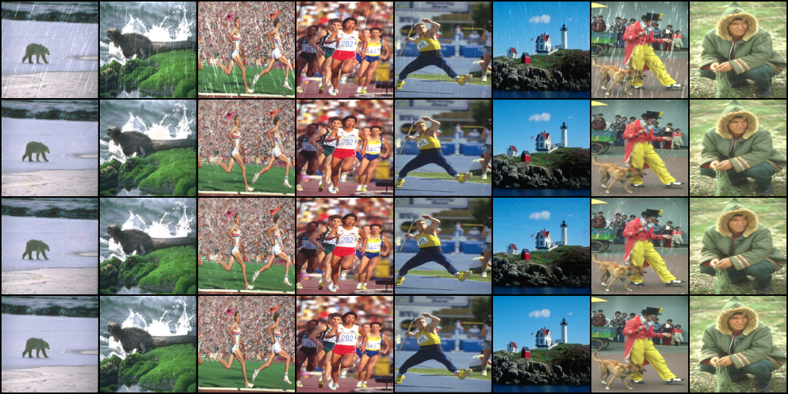
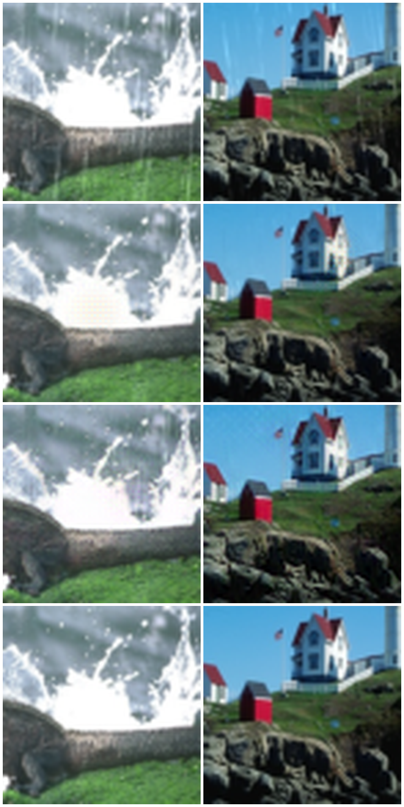

# Part2 第二部分 任务一：基于像素到底有什么不好

## 1. 为什么多套一个预训练模型，L1 就能更好地衡量感知差异

像素级别的 L1 做的事情很直接，两张图对应位置相减、取绝对值、求平均，就这三步。问题出在它是逐像素独立算的，算的时候不知道这个像素属于什么，只看这个点的数值差了多少。

这么算有两个方向的毛病。

一个是该迟钝的地方太敏感。比如模型输出的猫和原图比，整体往右挪了 2 像素，人眼根本看不出区别，但像素 L1 会在位移那一圈算出一大堆差异，因为原来黑眼睛的位置现在是白毛，原来白毛的位置现在是黑眼睛，数值全变了。

另一个反过来，该敏感的地方太迟钝。雨去掉了，但原来有雨那条线留下一块模糊补丁，数值上它和周围像素差不多，L1 算出来并不大，可是人一眼就看得出来，那块本该有一条笔直的边缘。

所以逐像素 L1 这两件事都判错了，人不在意的它算得很重，人在意的它算得很轻。

加上 VGG 之后比较的东西就换了，不再比像素值，比的是中间层的特征图。中间层有个性质，它一个值不是只看一个像素，是看输入里的一片区域，也就是感受野，层越深这片区域越大。所以到了中间层，一个特征值回答的不是"这个点什么颜色"，而是"我管的这片区域里有没有出现这类结构"，有的通道专门响应边缘，有的响应某个方向的条纹，有的响应某种颜色块。

拿刚才那两个例子再看一遍就清楚了

```text
猫挪了 2 像素 → 那片区域「有没有眼睛」的结论没变，特征差异很小
雨糊成一片    → 那片区域「有没有边缘」变了，特征差异明显
```

正好和人眼的判断一致。人不数像素，看的是结构、边缘、纹理还在不在。在特征空间里比，等于把"看着像不像"这个说不清的感觉，换成了一个能算出来的数。

至于 VGG 为什么有这个本事，因为它在 ImageNet 上做分类，要把一千个类别分对，它必须逐层学会从边缘到纹理到部件到物体这一套表示。这套东西本来是为分类学出来的，但恰好就是人看图时依赖的那些东西。

## 2. 这个预训练网络起到了什么作用

它是编码器，把像素翻译成结构描述。

```text
输入   (B, 3, H, W)        每个点是 RGB 三个数
         ↓   VGG19 前 35 层
输出   (B, 512, H', W')    通道变多，尺寸变小
```

具体尺寸是

```text
64 × 64   的图 → 走完 35 层 → (B, 512, 4, 4)
128 × 128 的图 → 走完 35 层 → (B, 512, 8, 8)
```

尺寸缩了四次，通道涨到 512，这个过程本身就是"从像素变成特征"：每池化一次位置信息被压缩一点，每过一批卷积通道里就多出一种"某类结构在不在"的响应。

这里我一开始理解错了，以为是往去雨模型里多加一层卷积。实际上它不装在模型里面，是挂在旁边的，UNet 完全不知道它存在，它只在算损失的时候被调一次。它也不是一层，前 35 层里是 16 个卷积、15 个 ReLU 加 4 个池化（第 5 个池化在索引 36，正好被切片切掉了）。

有三件事要说清楚。

一是我们只要它的一半。VGG19 分 features 和 classifier 两块，features 是卷积部分，classifier 是最后那个全连接分类头。我们只要 features，分类头直接丢，因为我们要的不是"这是第几类"，是中间那些特征图。

二是这个"会提特征"的能力不是为去雨设计的，是做分类时顺带练出来的副产品。题干问这个网络起到了什么作用，关键在于意识到我们借的是别人为另一个任务练出来的能力，而且借得很值。

三是它全程冻结，代码里体现成两句

```text
requires_grad_(False)   不算这些参数的梯度
eval()                  切成推理模式
```

这两个管的是不同的事，都得写。少写前者会白白算梯度、多占显存——特征是常量，算它们的参数梯度本来就没有意义。

至于 `eval()`，得说实话：在这份 VGG19 上它一个数都改不了。`.features` 里全是卷积、ReLU 和池化，既没有 Dropout 也没有 BatchNorm，没有需要切换模式的东西。但还是要写，因为换成带 BatchNorm 的骨干（比如 ResNet）结果就完全不同了——忘了 `eval()`，统计量会跟着当前这批输入走，同一张图放进不同的 batch，提出来的特征都不一样，损失就成了一个会晃的尺子。

为什么要冻结，因为尺子不能跟着被量的东西一起变，变了量出来的数就没意义了。训练时反向传播会穿过 VGG 一路回到 UNet，但 VGG 自己一个参数都不更新。

## 3. 感知损失的实现

代码在 `losses/perceptual_loss.py`，去掉注释后主体是这些

```python
class PerceptualLoss(nn.Module):
    def __init__(self):
        super(PerceptualLoss, self).__init__()
        self.vgg = vgg19(weights=VGG19_Weights.IMAGENET1K_V1).features[:35] \
                       .requires_grad_(False).eval()
        self.criterion = nn.L1Loss()
        self.register_buffer("mean", torch.tensor([0.485, 0.456, 0.406]).view(1, 3, 1, 1))
        self.register_buffer("std",  torch.tensor([0.229, 0.224, 0.225]).view(1, 3, 1, 1))

    def forward(self, generated, ground_truth):
        generated    = (generated    - self.mean) / self.std
        ground_truth = (ground_truth - self.mean) / self.std
        generated    = self.vgg(generated)
        ground_truth = self.vgg(ground_truth)
        return self.criterion(generated, ground_truth)
```

`forward` 其实就四步，归一化、过 VGG、再反过来过一遍、最后算 L1。下面说四个地方为什么这么写。

### 3.1 为什么要归一化

VGG 在 ImageNet 上训练的时候，输入是减过均值除过标准差的。我们的图是 0~1，直接送进去，分布和它训练时见的不一样，提出来的特征就不是它本来要表达的那些东西。

这一步不做不会报错，只会让效果莫名变差，属于最难查的那类问题。

### 3.2 为什么截到前 35 层

`.features` 一共 37 层，后面还有池化。截到 35 是题干要求的。另外从道理上讲，35 层之后的感受野已经超过整张图了，特征变成"整张图是什么"的全局判断，对"这一小块雨丝修得细不细"没帮助，还多占显存。

### 3.3 mean / std 为什么用 register_buffer

一开始我是直接在 `forward` 里写 `torch.tensor([...])`，这样写有两个坑。

一是 `torch.tensor` 默认建在 CPU 上，而图在显卡上，一上显卡就会报

```text
RuntimeError: Expected all tensors to be on the same device,
but found at least two devices, cuda:0 and cpu!
```

二是形状，`torch.tensor([...])` 出来是形状 `(3,)`。PyTorch 的广播是从最后一维往前对齐的，所以它会去和 W 对齐。W 是 64 或 128，和 3 既不相等也不是 1，于是直接报

```text
RuntimeError: The size of tensor a (64) must match
the size of tensor b (3) at non-singleton dimension 3
```

这个会报错，比静默算错好一点，但报错信息说的是"最后一维对不上"，很容易让人以为是图的分辨率出了问题，而不是均值张量的形状不对。必须摆成 `(1, 3, 1, 1)`，只让通道那一维是 3。

`register_buffer` 的好处是它登记的东西不是参数，不会被优化器更新，但会跟着 `.to(device)` 一起搬走，正好适合这种"我需要在显卡上的常量"。

### 3.4 两个自检

写完先单独测，不急着训练

```python
p = PerceptualLoss()
gen = torch.rand(2, 3, 64, 64, requires_grad=True)
gt  = torch.rand(2, 3, 64, 64)

print(p(gen, gen).item())                                  # 同一张图
p(gen, gt).backward()
print(any(q.grad is not None for q in p.parameters()))     # VGG 有没有被更新
```

结果

```text
同一张图的损失        0.000e+00
不同两张图的损失      0.706327
VGG 参数有没有梯度    False
特征图尺寸            (2, 512, 4, 4)
```

第一条是自洽性检查，同一张图过两遍 VGG，特征必须完全一样，损失必须是 0。这条如果不是 0，基本只可能是归一化写错了——比如一边做了一边没做，或者两次用了不同的 mean/std。

我一开始以为它还能顺带测出"忘了切 `eval()`"，后来发现测不出来，原因有两层。第一层是这份 VGG19 的 `.features` 里根本没有 BatchNorm 和 Dropout，`eval()` 改不了任何数值。第二层更普遍：就算换成带 BatchNorm 的骨干，同一张图喂两遍，BatchNorm 用的还是这张图自己算出来的统计量，两遍结果依旧一模一样，`p(gen, gen)` 照样是 0。漏写 `eval()` 的症状只在训练时才显出来——特征跟着 batch 的组成晃，这个自检看不见。

第二条那个 0.706 看着偏大，是因为测试时喂的是随机噪声，真实图像之间的特征差异小得多。

第四条从 `64×64` 变成 `4×4`，通道从 3 变成 512，正好是"像素被换成结构描述"的具体样子。

## 4. 训练结果与对比

光把感知损失写对还不够，得看它到底有没有用。同一个 UNet 训了两遍，命令行只差一个开关。

```text
数据          Rain200L，训练 3600 张 / 测试 400 张
输入          统一 resize 到 128×128
batch / lr / epochs        8 / 1e-4 / 20
λ_pixel / λ_perceptual     1.0 / 0.1
A 组  python main.py --model unet --use_perceptual_loss
B 组  python main.py --model unet
```

两组的模型、数据路径、优化器、学习率、轮数都一样，我主动改的只有那 0.1 的感知项。

不过这里有个缺陷得先说清楚：`main.py` 里没有固定随机种子，两次运行的权重初始化和每个 epoch 的打乱顺序是不同的。所以这不是严格的控制变量实验，只能说明"在这两次运行里"感知损失没有带来收益，不能排除初始化的运气成分。真要干净，得加 `torch.manual_seed`，并且两组各跑几个种子取平均——这一点我没做。

结果取测试集 PSNR 最高的那一轮（两组都落在第 19 轮）：

| | PSNR | SSIM | LPIPS |
|---|---|---|---|
| B　UNet + L1（对照） | **32.9006** | **0.9374** | **0.0340** |
| A　UNet + L1 + 感知 | 31.2338 | 0.9151 | 0.0428 |

三项指标纯 L1 那组全赢，连 LPIPS 也是它更低。这跟"加感知损失是为了让 LPIPS 更好看"的直觉是反的，下面分开说。

时间代价也记一下：每个 epoch 从 31 秒变成 38 秒，多出来的是 VGG 的前向计算，涨了约 23%。

### 4.1 日志里 pixel_loss 那一列不能直接读

一开始我是照日志对比的，A 组 pixel_loss 0.0748、B 组 0.0126，差了将近 6 倍，看着像"加了感知损失把像素损失拖垮了"。后来发现这个数被污染了，源头在 `train_one_epoch` 这三行：

```python
pixel_loss = args.lambda_pixel * pixel_loss_fn(derained, clean)
total_loss = pixel_loss          # 不是复制，是两个名字指向同一个 tensor
if args.use_perceptual_loss:
    p_loss = args.lambda_perceptual * perceptual_loss_fn(derained, clean)
    total_loss += p_loss         # 原地加法，pixel_loss 跟着一起变
```

`total_loss = pixel_loss` 只是给同一个 tensor 起了第二个名字，没有分配新内存。`+=` 在 tensor 上是原地操作，改的是那块内存本身，所以 `pixel_loss` 也被加上了感知项。日志里 A 组那个 0.0748，真实含义是「像素损失 + 0.1 × 感知损失」。

减回去就对了：

```text
A 组 第 19 轮   日志 0.0748 − 感知项 0.0582 = 真实像素损失 0.0166
B 组 第 19 轮                                真实像素损失 0.0126
```

两组真实的像素损失只差 1.3 倍，不是日志上的 5.9 倍。

要说清楚的是：**这个写法只错在日志上，训练本身没问题**。`total_loss` 作为「像素 + 感知」的和是正确要反传的量，梯度没有偏差。错的只有打印出来给人看的那一个数。

### 4.2 为什么没赢

四个原因，按我判断的轻重排。

**一是权重给得太小。** λ_pixel 是 1.0，λ_perceptual 是 0.1，感知项在总损失里最多占一成。4.1 反推出来的结果也在说同一件事：加上感知项之后，真实的像素损失只涨了 1.3 倍，说明优化器走的还是 L1 那条路，感知项只是轻轻拽了一下。这么小的改动，很难让输出产生明显变化，4.3 的放大图也印证了这一点。

**二是截在第 35 层太深了。** 128×128 的图走完 35 层只剩 8×8，一个特征点管整张图六十四个格子里的一个，它回答的是"这一片里有没有某类结构"，对"这条雨丝修干净没有"几乎没有分辨力。要去掉雨丝这种又细又长的高频东西，浅层才有用——`relu2_2` 那一档还是 32×32，`relu3_3` 是 16×16，看得见细结构。题干规定截到前 35 层，我照做了，但这个深度本身就不太适合去雨这个任务。

**三是评价指标天然偏向像素。** PSNR 由 MSE 直接算出来，SSIM 比的是局部亮度和结构，用 L1 训练几乎就是在朝这两个指标优化。感知损失优化的是另一个目标，在别人的考卷上当然吃亏。LPIPS 看着像"感知指标"，但它用的是 AlexNet 多层特征加一组学出来的线性权重，跟 VGG 第 35 层的 L1 不是同一个东西，帮不到它。

**四是只训了 20 轮。** 两组到第 19、20 轮都还在动，曲线没有走平——B 组从第 15 轮 32.67 一路爬到第 19 轮 32.90，A 组也是。在没收敛的位置比较优劣，本来就不太靠得住。

还有两点要自己交代：λ 只试了 0.1 这一个值，没做扫参；随机种子没固定，也没跑多个种子取平均。所以准确的说法是「λ = 0.1、20 轮、前 35 层特征、各跑一次这几个条件放在一起，感知损失没有收益」，不能说成「感知损失没用」。

### 4.3 目视对比

同样的 8 张测试图，四行分别是雨图、纯 L1、L1 + 感知、真值：



整图看不出差别，放大到局部再看一次（右侧是灯塔那张的天空区域，雨丝最明显的地方）：



两行模型的输出几乎分不出来，都能把雨丝去掉，也都在溅起来的水花那里偏亮、比真值糊一点。感知损失没有把边缘变得更锐利。

这跟 4.2 第一条对得上：λ = 0.1 时感知项弱到不足以改变输出。必须说明的是，「肉眼看起来差不多」是我的主观判断，没有做量化；能拿出来当证据的只有 4.2 那张指标表。

### 4.4 如果重做

按现在的理解，我会改三处：

```text
λ_perceptual      0.1 → 1.0 甚至 10，让它真的参与到优化里
特征层            前 35 层 → relu2_2 / relu3_3，保留 32×32 / 16×16 的分辨率
轮数              20 → 50 以上，先让两组都收敛再比
```

另外还有一个更根本的看法：Rain200L 是合成雨，`有雨 = 无雨 + 雨层` 是精确成立的，目标图和输入逐像素对应。在这种数据上，像素损失就是和任务匹配的指标，PSNR 高的模型本来就更接近真值。感知损失的长处在于允许输出和真值不完全对齐——真实雨、去雾、超分这类有不确定性或者目标是"看着舒服"的任务才用得上。拿它来打一个合成雨的数据集，考卷本身就不对路。
