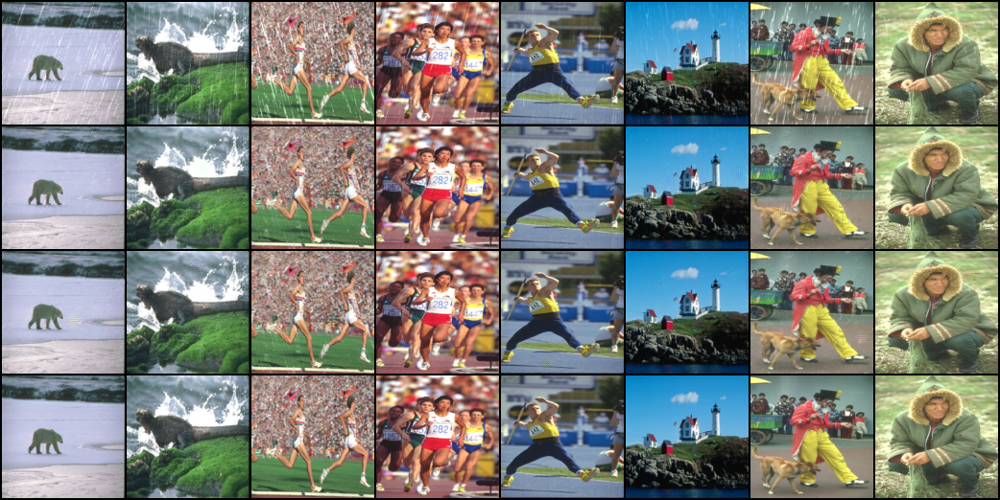

# Part2 第二部分 任务三：改造感知损失函数，使用特征做对比

## 1. 这一题到底改了什么

对比损失和感知损失用的是同一个预训练网络、同一个中间层，唯一变的是比较方式。

```text
感知损失    特征图 (B, 512, H', W')   逐位置相减、取绝对值、求平均
对比损失    特征向量 (B, 512)          每个样本一条向量，算夹角
```

前者问的是「每个位置上差多少」，后者问的是「整体像不像」。

这个区别决定了它们对错误的容忍方式不同。感知损失保留了位置信息，输出图和真值在空间上错开一格，就会在错开的那一圈算出很大差异；对比损失先把空间维度平均掉，位置信息整个丢了，只剩「这张图整体由哪些结构组成」。

丢掉位置是缺点，也是它存在的理由。它管不了雨丝具体该修在哪个像素上，这件事交给 L1 去做；它能做的是把整体的颜色、结构、质感拉住，不让输出往奇怪的方向漂。

## 2. 为什么必须给三个输入

只写「预测要像无雨真值」这一项是不够的。

Rain200L 是合成数据，`有雨 = 无雨 + 雨层`，两张图本来就几乎一样。我实测了一下，`cos(无雨, 有雨)` 是 0.9675。也就是说，模型只要把输入原样吐出来，第一项就能拿到 0.9675 的高分，根本不用学任何去雨的东西。

所以加第二项：预测还要和「有雨输入」不像。

```text
loss = mean( -cos(预测, 无雨) + cos(预测, 有雨) )
      └── 越大越好，取负后变成越小越好
                                   └── 本来就要求越小越好，不改符号
```

两项一个往回拉、一个往前推，中间才夹出一个「真的做了修改、而且改对了方向」的解。这是它和感知损失最本质的区别：感知损失比的是两个量的绝对差，对比损失比的是三个量之间的相对关系。

## 3. 代码实现

文件是 `../losses/easy_contrastive_loss.py`，主干如下。

```python
def forward(self, derained, clean, rainy):
    derained = (derained - self.mean) / self.std
    clean = (clean - self.mean) / self.std
    rainy = (rainy - self.mean) / self.std

    derained = self.vgg(derained)
    with torch.no_grad():
        clean = self.vgg(clean)
        rainy = self.vgg(rainy)

    derained = self.pool(derained).flatten(1)
    clean = self.pool(clean).flatten(1)
    rainy = self.pool(rainy).flatten(1)

    sim1 = -F.cosine_similarity(derained, clean, dim=1)
    sim2 = F.cosine_similarity(derained, rainy, dim=1)
    return (sim1 + sim2).mean()
```

### 3.1 特征从哪来

和感知损失完全一样：VGG19 的前 35 层，权重冻结，切到 eval 模式。归一化用的 mean / std 也照抄，理由和任务一 3.3 节写的三条一样（跟着 `.to(device)` 走、进 `state_dict`、不被优化器更新），所以同样用 `register_buffer`。

不一样的地方是输出形状。感知损失停在这一步：

```text
(B, 3, H, W)  →  VGG19 前 35 层  →  (B, 512, H', W')
```

对比损失还要再往下走一步，把四维压成一维。

### 3.2 AdaptiveAvgPool2d 在做什么

```text
(B, 512, H', W')  →  AdaptiveAvgPool2d(1)  →  (B, 512, 1, 1)
                                                  ↓ flatten(1)
                                             (B, 512)
```

`AdaptiveAvgPool2d(1)` 的意思是「不管输入多大，输出都给我 1×1」。它对每个通道单独做一次全局平均，H'×W' 个格子里的数全加起来求平均，每个通道只剩一个数。

128×128 的图走到第 35 层，特征图是 8×8，所以每个通道是在 64 个数里取平均。这一步做完，「雨丝在这张图的左下角」这种信息就没了，留下的是「这张图整体有没有雨、整体偏亮还是偏暗」。

`flatten(1)` 里的 1 很关键，它表示从第 1 维开始压平，把 512×1×1 压成 512，batch 维原样保留。如果直接 `flatten()` 不填参数，会把整个张量压成一维，batch 维一起没了，后面算余弦相似度就变成在整个 batch 上算一个数，这是错的。

### 3.3 余弦相似度的维度

```python
F.cosine_similarity(derained, clean, dim=1)
```

`dim=1` 指的是通道维。输入是 `(B, 512)`，沿第 1 维算夹角，输出是 `(B,)`，每个样本一个相似度值。

这个参数填错不报错，只是结果错。如果填 `dim=0`，它会沿着 batch 维算，变成「第 i 个通道在所有样本上的相似度」，语义完全变了，而且形状对得上、程序照跑，属于最难查的那类 bug。

算出 `(B,)` 之后还要 `.mean()` 才是标量。损失函数必须返回标量，否则 `backward()` 会报「grad can be implicitly created only for scalar outputs」。

### 3.4 符号

优化器只会把损失往小了推，所以「希望越大越好」的那一项必须取负。

```text
希望 cos(预测, 无雨) 越大越好   →  写成 -cos(预测, 无雨)
希望 cos(预测, 有雨) 越小越好   →  写成 +cos(预测, 有雨)
```

两项各带权重 1，直接相加。没做加权是因为这两件事在逻辑上是同等重要的，没有理由偏袒一边。

### 3.5 计算图只留在一条路上

这三张图里只有 `derained` 是从模型输出来的，梯度必须能顺着它传回 UNet。`clean` 和 `rainy` 是数据集直接给的常量，跟模型参数没有关系，套 `torch.no_grad()` 可以省下两份中间激活值的显存。

这里我踩过一次坑：一开始把三张图一起写在 `with torch.no_grad():` 里面了。这样 `derained` 的计算图被整个掐断，反传时报

```text
RuntimeError: element 0 of tensors does not require grad and does not have a grad_fn
```

原因就是这个损失对模型参数不再有梯度，`total_loss.backward()` 无从下手。正确做法是只包住后两张，第一张留在 `no_grad` 外面。

### 3.6 main.py 的三处改动

```text
get_args         加 --use_contrastive_loss（store_true）和 --lambda_contrastive（默认 0.05）
train_one_epoch  多接一个 contrastive_loss_fn 参数，加一个 if 分支
main             实例化损失对象，并把它传进 train_one_epoch
```

实例化那一行写成条件表达式：

```python
contrastive_loss_fn = EasyContrastiveLoss().to(device) if args.use_contrastive_loss else None
```

没开开关时不构造对象，因为 `EasyContrastiveLoss()` 一构造就要加载一份 VGG19 权重上显卡。这个脚本里已经有 `PerceptualLoss`（也是 VGG）和 LPIPS（AlexNet），再加一份纯属浪费显存。`None` 也不会被调用，因为 `if args.use_contrastive_loss:` 整个分支本来就跳过了。

`train_one_epoch` 里进度条的写法改成了先攒字典再一次性输出：

```python
d = {"pixel_loss": pixel_loss.item()}
if args.use_perceptual_loss:
    ...
    d["perceptual_loss"] = p_loss.item()
if args.use_contrastive_loss:
    ...
    d["contrastive_loss"] = c_loss.item()
loop.set_postfix(**d)
```

原因是 `tqdm` 的 `set_postfix(**kwargs)` 是整体替换而不是累加，分两次调用会把前一次的列冲掉。而且两个开关互相独立，用 if/else 硬嵌套要写四种组合，用字典就是两个独立判断加一次输出。

## 4. 训练与结果

配置和任务一的 A/B 组保持一致，只多开一个开关：

```text
数据        Rain200L，训练 3600 张 / 测试 400 张
输入        统一 resize 到 128×128
batch / lr / epochs        8 / 1e-4 / 20
λ_pixel / λ_contrastive    1.0 / 0.05
命令        python main.py --model unet --use_contrastive_loss
```

### 4.1 先量一下这个损失到底有多大

代码跑通之后，进度条上 `contrastive_loss` 一直是负数、而且小到 `-1.06e-5` 这个量级。一开始怀疑自己符号写反了，写了个诊断脚本把两项拆开单独统计，在测试集上取样 10 个 batch：

```text
cos(预测, 无雨)    0.9847    希望越大越好
cos(预测, 有雨)    0.9851    希望越小越好
两者相减           0.0004    就是原始损失值
乘 λ=0.05 之后     0.00002   进度条上看到的数

参考 cos(无雨, 有雨)  0.9675   两个锚点本来就多像
```

看到最后一行就明白了，不是 bug。

Rain200L 是合成雨，无雨图和有雨图是同一个场景，雨层只扰动了一部分像素，而 VGG 特征经过全局平均之后只剩「这张图整体长什么样」，雨丝对整体内容的扰动很小，所以两个锚点自己有 96.75% 像。

这直接决定了这个损失的可用区间。就算模型完美输出无雨真值，损失也只能到

```text
-cos(无雨, 无雨) + cos(无雨, 有雨) = -1 + 0.9675 = -0.0325
```

也就是说，从当前值到理论最优，总共只有 0.03 左右的空间可走。再乘 0.05 的权重，它和同一时刻的像素损失（约 0.017）差了两个数量级以上。

### 4.2 20 轮结果

单看一组数会得出错误结论，所以我先把纯 L1 跑了两遍。`main.py` 没有固定随机种子，两次运行的初始化和每轮打乱顺序都不同，这两次之间的差距就是「运气」的量级。

结果取测试集 PSNR 最高的那一轮：

| | PSNR | SSIM | LPIPS |
|---|---|---|---|
| 纯 L1　第一次（第 19 轮） | 32.9006 | 0.9374 | 0.0340 |
| 纯 L1　第二次（第 19 轮） | 33.2291 | 0.9408 | 0.0313 |
| L1 + 对比损失（第 20 轮） | 33.1373 | 0.9382 | 0.0330 |

如果只看第一行和第三行，会以为加了对比损失之后 PSNR 涨了 0.24 dB，三项指标都变好了一点。但第二行把这个说法打掉了：

**同一个配置（纯 L1）跑两次，PSNR 自己就差了 0.33 dB。**

这个波动比「加不加对比损失」带来的 0.24 dB 还大。而且对比损失那组的 33.1373 正好落在两次纯 L1 的 32.9006 和 33.2291 中间，SSIM、LPIPS 也都在同一个区间里。

所以正确的结论是：在这套实验条件下，对比损失的指标差异完全被随机种子的波动掩盖，无法区分。不能说它让模型变好，也不能说它让模型变差。

目视对比也支持这个判断，四行分别是雨图、纯 L1、L1 + 对比、真值：



纯 L1 和加对比损失的两行几乎分不出来，都能去掉大部分雨丝，也都在水花那里偏亮。

### 4.3 为什么贡献这么小

结果和 4.1 的测量是完全一致的，原因可以追到量级上。

```text
对比损失原始值        约 3.9e-4
乘 λ_contrastive=0.05  约 2e-5
同一时刻像素损失       约 1.7e-2
                       两者相差 800 倍以上
```

优化器看到的总损失里，1000 份里有 999 份是像素损失。对比项对梯度的贡献按同样的比例被压缩，它想推的方向几乎推不动参数。

再往下追一层，根本原因在数据而不在实现。对比学习起作用的前提是正负样本之间有足够的距离可推，而这个数据集里

```text
cos(无雨, 有雨) = 0.9675
```

两个锚点自己就有 96.75% 像。模型把输入原样输出，第一项就已经拿到 0.9675 的高分，第二项也没有多少可降的空间。整个损失的可优化区间只有 0.03 左右，模型几乎不费力气就能满足它，学习信号自然就弱。

换个角度说，这正是附加2 第 2 问想讨论的那个现象的一个实例：一项损失的名义权重（`λ = 0.05`）和它实际的影响力完全是两回事，真正决定影响力的是梯度量级，而梯度量级由这一项本身的可优化空间决定。

## 5. 局限和重做

**第一，只跑了单次，没有固定随机种子。** 4.2 里那次重复实验就是为了量化这个缺陷：同配置两次差 0.33 dB。要真正比较两个损失，需要固定 `torch.manual_seed`，每组跑三个以上种子取平均，并且报告标准差。这一次没做到，所以结论只能写成「在这几次运行的条件下无法区分」。

**第二，λ 只试了 0.05 一个值。** 既然量级只有像素损失的千分之一，把 λ 调到 5 甚至 50 才可能让它真正参与优化。但按 4.1 的分析，λ 调大之后抵消的是「被淹没」，剩下的问题仍然是「可优化区间只有 0.03」，作用幅度本身有上限。

**第三，池化方式可能选错了。** `AdaptiveAvgPool2d(1)` 把 H'×W' 个位置全部平均成一个数，空间信息完全丢失。而雨丝恰恰是空间局部的细长结构，「左下角有没有雨」这种信息正是该保留的。更对症的做法是分区池化：

```text
现在   (B, 512, 8, 8) → AdaptiveAvgPool2d(1) → (B, 512)       空间信息全丢
改法   (B, 512, 8, 8) → 分成 4×4 区域分别平均 → (B, 512, 16)  保留粗略位置
```

这样正负样本的差异会集中在「雨丝出现在哪一片」，而不是被全局平均抹平，`cos(无雨, 有雨)` 应该会明显下降，可优化的空间随之变大。这是我如果重做最想先试的一个改动。

**第四，任务本身是合成雨。** 题干要求实现这个损失并且跑通，这一部分我做到了，损失函数的行为（三项输入、余弦相似度、符号处理）都符合预期。但它在一套「正负样本本来就几乎重合」的数据上失效，是很自然的结果。如果要让它发挥作用，真实雨天的数据集（雨层与背景的差异远大于合成雨）才是合适的场所。

一句话总结这个过程：

```text
实现是通的 → 指标看着涨了 → 但重复实验说明是种子波动
→ 回头量级，发现它根本没参与 → 再往下追，是数据的可优化区间太小
```

我觉得这条链条比「我实现了对比损失，指标提升了」更有价值，因为它说明结论是怎么被检验出来的。
